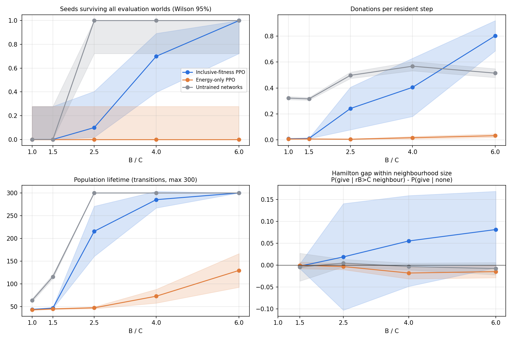

# Emergent Kin Selection and Spatial Assortment in Multi-Agent Reinforcement Learning

CS329 Multi-Agent Systems · Group 21 · IIT Gandhinagar
Vansh Barfiwala · Pratham Choksi · Shubham Chandak

📄 **[Final report (PDF)](report/final_report.pdf)** ([LaTeX source](report/final_report.tex)) · 🌐 **[Project page: run the trained models in your browser](https://chandak-shubham.github.io/cs329_project/)** · 📊 Results: [Study B](results/study_b_hamilton/results.md), [Study C](results/study_c_robustness/results.md), [Study A](results/study_a_energy/results.md)

---

## The question

Agents on an 18 × 18 grid lose energy every step. They can donate energy to a neighbour at a cost $C$, and the neighbour receives $B > C$. Donations are the only source of new energy, so without cooperation the population starves, yet each individual is better off not giving.

Each of 24 founder families owns its own gated-attention network trained with PPO. Children inherit their family's network, and surviving families are selected between episodes. Agents see each neighbour's genetic tag, which may be corrupted, and its recent giving.

**Can self-interested learners discover cooperation, and does what they learn follow Hamilton's rule $rB > C$?**

## Main results

10 independent training seeds per condition, 3 fresh evaluation worlds per seed. All numbers come from the `analysis.json` files in `results/`.



| B/C | Seeds surviving: inclusive reward | Seeds surviving: energy-only reward | Seeds surviving: untrained networks | Donations / resident-step: inclusive | Donations / resident-step: energy-only |
| --- | --- | --- | --- | --- | --- |
| 1.0 | 0/10 | 0/10 | 0/10 | 0.009 | 0.006 |
| 1.5 | 0/10 | 0/10 | 0/10 | 0.011 | 0.007 |
| 2.5 | 1/10 | 0/10 | 10/10 | 0.242 | 0.005 |
| 4.0 | **7/10** | 0/10 | 10/10 | 0.405 | 0.016 |
| 6.0 | **10/10** | 0/10 | 10/10 | **0.803** | 0.032 |

1. **Individual reward destroys cooperation.** With the energy-only reward from our proposal, PPO learns to stop giving and no population survives (0/50 runs). Untrained networks with the same founders do survive, so learning removes cooperation that was already there. Study A confirms this in 18 robustness conditions: in all 90/90 runs, trained populations gave less than untrained ones.
2. **Hamilton's kin term preserves it.** Adding $r_{ij}B$ to the donor's reward: 18/50 runs survive versus 0/50 (Fisher $p = 1.2\times10^{-6}$), and 17/20 versus 0/20 at $B/C \ge 4$ ($p = 2.6\times10^{-8}$).
3. **Learned giving follows Hamilton's threshold.** Below it ($B/C \le 1.5$) inclusive learners also abandon giving; at $B/C = 6$ they give more than untrained networks in 9/10 seeds.
4. **Kin information decides *whom* agents help, not whether they survive** (Study C, $B/C = 4$). Paying for every gift (prosocial) keeps all populations alive; only the kin-weighted reward makes agents favour relatives (share of gifts with $rB > C$: +0.10 over a kin-blind reward of the same size, 8/10 seeds, $p = 0.010$).
5. **Kin recognition is the weak link.** Learners rely less on a corrupted genetic cue but never switch to behavioural history, and they keep feeding genetic mimics, which a simple reputation rule ignores completely.
6. **Limits.** At $\gamma = 0.99$ both rewards survive equally rarely (2/10 each); 4× more training at $B/C = 2.5$ did not help.

## Repository layout

```
report/        final_report.tex (+ PDF) and the figures it uses
frontend/      index.html: the project page (GitHub Pages), its data exporter, site builder and browser checks
src/
  environment/ spatial donation game: energy, starvation, mitosis, genetic cue, mimics
  networks/    gated-attention policy, MLP ablation, scripted strategies
  training/    per-family PPO with inheritance and selection; Studies A, B and C
models/        trained checkpoints (.pt) and their training records (.json), one folder per study
results/       per study: results.md, analysis.json, CSV tables, raw evaluation logs, archived training source
plots/         all figures, one folder per study
evaluation/    analysis, figure and verification scripts
tests/         Python and browser-engine tests
```

| Study | Folder name | What it tests |
| --- | --- | --- |
| A | `study_a_energy` | Energy-only reward in 19 robustness conditions (5 seeds, 95 models) |
| B | `study_b_hamilton` | Energy-only vs inclusive reward at five B/C levels, plus noise, mimics and ablations (20 conditions, 200 models) |
| C | `study_c_robustness` | Prosocial and kin-blind reward controls and robustness at B/C = 4, strategy sweep (18 conditions, 180 models) |

## Check the results without retraining

* **In the browser.** The [project page](https://chandak-shubham.github.io/cs329_project/) downloads a committed checkpoint, checks its SHA-256 against its training record, and runs all 24 family networks with the saved founder genomes. *Reproduce a result* reruns all 10 seeds of a condition and puts the outcome next to what the Python evaluation recorded. The page's data and research section are generated from `results/` by `frontend/export_web_data.py`.
* **In Python** (about 2 minutes per study):

```powershell
python -m pip install -r requirements.txt
python evaluation/verify_hamilton.py                      # Study B
python evaluation/verify_hamilton.py --study robustness   # Study C
```

The verifier checks every model's SHA-256 and training settings, recomputes the headline numbers from the raw evaluation logs (Study B) or checks that every attack delivered its mimics (Study C), and re-simulates saved models in the same seeded worlds, where every recorded metric must match exactly (`--all` for every model).

## Reproduce from scratch

Python 3.12, CPU only. Completed runs are reused, so an interrupted run can be restarted.

```powershell
python -m pip install -r requirements.txt
python -m pytest -q                                   # Python tests
node --test tests/web_simulation.test.cjs             # browser-engine tests

python src/training/hamilton_study.py --workers 14         # Study B, about 2 hours on 14 cores
python evaluation/hamilton_report.py
python src/training/hamilton_robustness.py --workers 14    # Study C, about 2.5 hours
python evaluation/robustness_report.py
python src/training/inheritance_study.py --complete --steps 2048 --workers 3   # Study A
python evaluation/inheritance_report.py
python evaluation/report_figures.py                        # extra report figure
python frontend/export_web_data.py                         # refresh the project page (--check to verify)
```

The report is compiled from `report/final_report.tex` with the PRIMEarxiv template (for example on Overleaf; `PRIMEarxiv.sty` comes with the template).

## Project page

`frontend/index.html` runs entirely in the browser: pick a training condition and seed, play it, change $B$ and $C$, add mimics, or switch to a scripted rule. The browser engine is tested against the Python environment for identical observations, transitions and action probabilities. Browsers block file access from `file://` pages, so open the project page online, or run `python -m http.server` in this folder and open <http://localhost:8000/frontend/>. The site is published by `.github/workflows/pages.yml` (Settings → Pages → Source: GitHub Actions).
