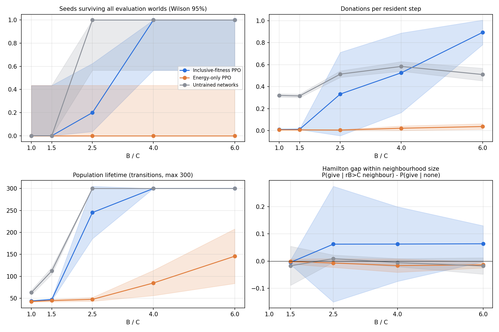
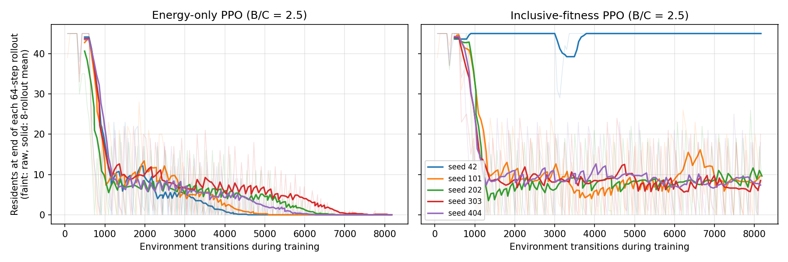
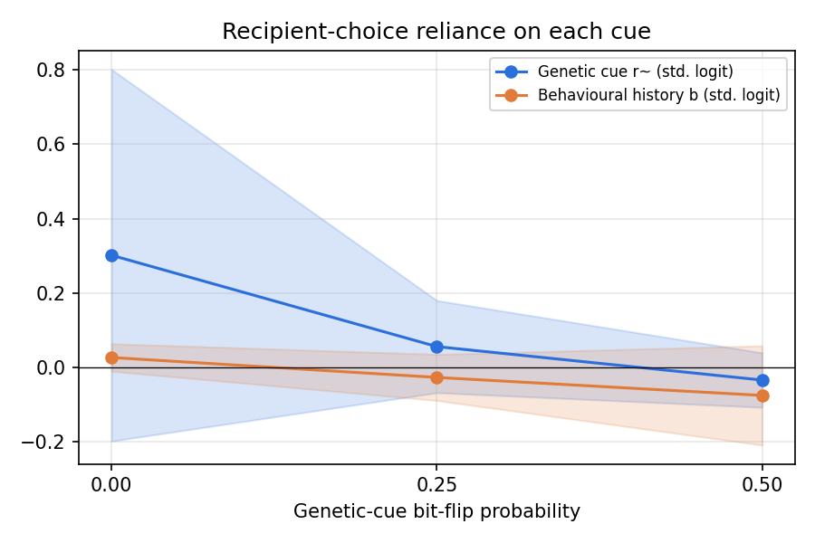

# Does Learning Need Kinship? Individual and Inclusive-Fitness Reinforcement Learning in a Spatial Donation Game

**CS329 Multi-Agent Systems — Group 21, IIT Gandhinagar**
Vansh Barfiwala (24110380) · Pratham Choksi (24110275) · Shubham Chandak (24110335)

---

## Abstract

Cooperation is costly to the individual, so why would self-interested learners cooperate? We study this in a spatial donation game. Agents on a grid lose energy every step, can donate energy at cost $C$ to give a neighbour $B>C$, and reproduce or starve. Founder families own independent gated-attention policies trained with PPO; children inherit their family's policy, and surviving families are selected between episodes. Agents observe a possibly corrupted genetic cue and each neighbour's recent giving. With the purely individual energy reward proposed in our ideation, PPO **unlearns cooperation**. In all 90 of 90 runs across 18 robustness conditions, trained populations gave less than untrained ones, and in a matched five-level $B/C$ sweep no energy-only population survived (0/25). Adding Hamilton's inclusive-fitness term $r_{ij}B$ to the donor's reward changes this: inclusive learners gave more in 24/25 paired runs ($p=1.6\times10^{-6}$) and survived in 10/10 runs at $B/C\ge4$ (energy-only 0/10, Fisher $p=1.1\times10^{-5}$). Learned giving follows Hamilton's threshold. Below it ($B/C\le1.5$), inclusive learners abandon giving; above it ($B/C=6$), they give more than untrained networks in 5/5 seeds. Learners prefer more related recipients, and when the genetic cue is corrupted its weight falls in all seeds. However, they never learn to rely on behavioural history and do not resist genetic mimics, which a simple reputation rule defeats completely. The learning signal, not the architecture, decides whether cooperation can be learned; recognising kin remains the weak link.

---

## 1. Decision problem and motivation

Helping costs the helper and benefits someone else. In a population with a scarce resource, a selfish individual who accepts help but never gives has more energy than one who gives. Yet cooperation is common in nature. Kin selection, direct and indirect reciprocity, and spatial structure are the classic explanations [10]; Hamilton's kin-selection theory is the one we study. A gene for helping can spread when helpers preferentially help relatives who carry the same gene, specifically when

$$ r\,B > C, $$

where $C$ is the cost to the helper, $B$ is the benefit to the recipient and $r$ is their genetic relatedness [1].

We model this as a **multi-agent decision problem**. Agents live on a grid, burn energy every step, and can either move or donate energy to a neighbour. Energy enters the system only through donations: each one creates $B-C>0$ of net energy. Without cooperation the population starves. The dilemma is that each individual is better off not donating.

Multi-agent reinforcement learning (MARL) agents usually maximise their *own* return. Sequential-social-dilemma and common-pool studies [2]–[7] typically add intrinsic motivations, inequity aversion or gifting mechanisms to obtain cooperation. We ask a sharper question: **is a purely individual learning signal enough for cooperation to emerge in a population with inheritance and selection, or must the learning signal itself include Hamilton's kin term?** We then ask whether learned helping obeys Hamilton's inequality, and how learners respond when the genetic cue they rely on becomes unreliable or is faked by mimics.

## 2. Model

### 2.1 Agents, information and actions

The system is a partially observable Markov game on an $18\times18$ torus with a dynamic population $\mathcal N_t$ (capacity $N_{\max}=45$, $N_0=24$ founders).

| Element | Definition |
| --- | --- |
| Agent state | Position $p_i$, energy $E_i$, 8-bit chromosome $c_i\in\{0,1\}^8$, last $K=10$ actions, age, family $f(i)$ (the founder whose network the agent uses) |
| Neighbourhood | $\mathcal N^\rho_i$: all agents within Chebyshev radius $\rho=3$ (up to 48). The observation $\Omega_i\subseteq\mathcal N^\rho_i$ holds the 8 nearest. |
| Observation | $o_i = \big(E_i/E_{\text{mit}},\ \text{age}_i,\ \{\Delta p_{ij}/\rho,\ E_j/E_{\text{mit}},\ \tilde r_{ij},\ b_j\}_{j\in\Omega_i}\big)$ |
| Actions | $\mathcal A_i=\{\text{N},\text{S},\text{E},\text{W},\text{stay}\}\cup\{\text{give}(j): j\in\Omega_i\}$. *Not giving* (moving or staying) is the defect choice. Giving is masked unless $E_i>C$. |

**Genetic cue.** Normalised Hamming *similarity* $h_{ij}=1-\tfrac18\sum_k|c_i^{(k)}-c_j^{(k)}|$. Baseline-corrected cue $\tilde r_{ij}=\max\!\big(0,\frac{h_{ij}-\bar h}{\max(1-\bar h,\epsilon)}\big)$, where $\bar h$ is the mean similarity over active pairs. With cue noise $\nu$, every observed bit is flipped independently with probability $\nu$ at every step. The true chromosomes are unchanged.

**Behavioural cue.** $b_j$ is the fraction of $j$'s last $K$ actions that were donations *given* by $j$. A newborn starts at the prior $b_0=0.5$.

**Mimics** (attack conditions). At $t=10$, six non-learning invaders are placed in random empty cells. They carry the modal resident chromosome, so their genetic cue looks like kin, but they never donate. They are "green-beard" cheaters [9]: carriers of the marker without the helping behaviour.

### 2.2 What is known and what is unknown

| Known to the agent | Unknown to the agent (must be learned or inferred) |
| --- | --- |
| Own energy and age; neighbours' relative positions and energies | The value of giving to a particular neighbour |
| The observed (possibly corrupted) genetic cue $\tilde r_{ij}$ | The true relatedness $r_{ij}$ and how reliable $\tilde r_{ij}$ is ($\nu$) |
| Each neighbour's recent giving $b_j$ | Who is a mimic; what policies neighbours run |
| — | $B$, $C$, metabolic costs, the environment dynamics (model-free learning) |

### 2.3 Dynamics

One transition proceeds as follows. Actions are applied simultaneously. Movement conflicts are resolved randomly, and swaps and chains are allowed. Energy is then updated:

$$ \Delta E_i = -c_{\text{base}} - c_{\text{dens}}\,|\mathcal N^\rho_i| - C\,\mathbb 1[a_i=\text{give}(\cdot)] + B\sum_{j}\mathbb 1[a_j=\text{give}(i)] . $$

Every donation therefore creates $B-C$ units of net energy. Total energy is **not** conserved. Agents with $E_i\le0$ die. An agent with $E_i\ge E_{\text{mit}}$ divides, if capacity remains and a von Neumann neighbour cell is free (otherwise it waits). The parent and child each receive $E_i/2$, so mitosis alone conserves energy. The child inherits a copy of the chromosome with per-bit mutation probability $\mu$, the parent's family network, and $b_0=0.5$. Episodes last 300 transitions or until extinction.

Base parameters: $E_0=30$, $E_{\text{mit}}=60$, $C=2$, $B=5$ (so $B/C=2.5$), $c_{\text{base}}=0.6$, $c_{\text{dens}}=0.08$, $\mu=0.05$, $K=10$, $\rho=3$.

### 2.4 Rewards: the manipulated variable

Both rewards are computed before the mitosis split.

* **Energy-only (individual)**, the reward in the original proposal: $R_i=\Delta E_i$.
* **Inclusive fitness (Hamilton)**: $R_i=\Delta E_i+\sum_{j:\,a_i=\text{give}(j)} r_{ij}\,B$. Here $r_{ij}$ is the baseline-corrected similarity of the **true** chromosomes among residents, and $r_{ij}=0$ for mimics, which share no ancestry with residents.

Under the inclusive reward, the one-step effect of giving to $j$ on the donor's reward is exactly $r_{ij}B-C$. Hamilton's rule is therefore the immediate incentive. The agent is never told $r_{ij}$: it sees only $\tilde r_{ij}$ (possibly corrupted) and $b_j$, so it must learn whom to help. A unit test (`tests/test_hamilton_study.py`) verifies that giving changes the donor's reward by $-C+rB$ under the inclusive reward, by $-C$ under energy-only, and by $-C$ for a mimic recipient.

## 3. Research questions and hypotheses

* **RQ1 (core): can individual learning sustain cooperation?** We compare energy-only PPO with inclusive-fitness PPO, untrained networks and evolution without learning, in otherwise identical populations that also have inheritance and survivor selection. *H1:* energy-only PPO learns to stop giving and the population collapses; the inclusive reward sustains more giving.
* **RQ2 (Hamilton): does learned giving obey $rB>C$?** We sweep $B/C\in\{1,1.5,2.5,4,6\}$. *H2:* giving is more likely when a neighbour with $r B>C$ is available (positive *Hamilton gap*). In the decision regression, the effect of $\tilde r$ grows with $B/C$ (positive $\tilde r\times B/C$ coefficient). At $B/C=1$, where $rB>C$ is impossible, no cooperation should be learned.
* **RQ3 (cue reliability and mimicry): do learners shift trust from the genetic cue to behaviour when the cue is corrupted or faked?** *H3:* as $\nu$ rises, the genetic coefficient falls relative to the behavioural one. Mimics receive fewer gifts with a learned gate than with a fixed gate.
* **RQ4 (spatial assortment): does local reproduction create genetic clustering?** *H4:* adjacent chromosome similarity is higher with local than with random offspring placement.

## 4. Algorithms

### 4.1 Gated-attention policy (from the proposal, corrected)

1. **Contextual gate.** $(w^g_{ij},w^b_{ij})=\text{softmax}\,f_g([\tilde r_{ij},b_j,E_j,\ \mu_{\Omega_i},\sigma_{\Omega_i}])$, where $\mu_{\Omega_i},\sigma_{\Omega_i}$ are the neighbourhood mean and standard deviation of the three cues. The gate needs this context: a single pair contains no information about whether cues are corrupted, because corruption is a population-level property. Affinity: $q_{ij}=w^g_{ij}\tilde r_{ij}+w^b_{ij}b_j$.
2. **Encoding and attention.** $z_{ij}=\text{MLP}([\Delta p_{ij},E_j,\tilde r_{ij},b_j,q_{ij}])$ and $z_i=\text{MLP}(E_i,\text{age}_i)$. Multi-head attention (2 heads, $d=32$) with query $z_i$ over keys and values $\{z_{ij}\}$ gives $Z_i$.
3. **One joint action distribution.** Five movement logits $g_m(Z_i\Vert z_i)$ and one donation logit per neighbour $g_d(Z_i\Vert z_{ij}\Vert q_{ij})$ are concatenated. Invalid actions are masked and a **single softmax over all 13 actions** is taken. Critic: $V(Z_i\Vert z_i)$.

Because $\tilde r$ and $b$ also enter $z_{ij}$ directly, the gate weight $w^g$ alone is not a valid measure of reliance. We therefore measure reliance from **behaviour**: per-seed conditional-logit weights of the actual recipient choice on standardised $\tilde r$ and $b$ (§5.2–5.3). The gate weight is reported only as telemetry.

### 4.2 Learning: per-family PPO

Each of the 24 founders owns an independent network and Adam optimiser, trained with PPO [8]. Descendants act with their family's network, and each family network is updated by PPO only on its own members' transitions. Settings: rollout 64 transitions, 3 epochs, minibatch 64, learning rate $3\times10^{-4}$, $\gamma=0.9$, GAE $\lambda=0.95$, clip 0.2, value coefficient 0.5, entropy 0.01, gradient-norm clip 0.5. Death is terminal and no credit flows past it. A critic per family, rather than a centralised MAPPO critic, is used because rewards are individual and decentralised.

**Choice of $\gamma$ (disclosed).** In separate pilot runs (seed values 42, 101 and 202 at 4,096–8,192 transitions; these runs are not part of the reported data), inclusive-fitness PPO with $\gamma=0.99$ collapsed. Under the energy reward the return telescopes, $\sum_t \Delta E_t = E_{\text{end}}-E_0$, so long horizons mostly add uncontrollable metabolic variance, whereas the Hamilton incentive is immediate. We therefore use $\gamma=0.9$ for **every** condition and report a $\gamma=0.99$ condition as a sensitivity analysis. Energy-only PPO also fails at $\gamma=0.99$ (Study A).

### 4.3 Evolutionary outer loop: inheritance and selection

At the end of each episode (300 transitions or extinction), the next episode's 24 founders are drawn **with replacement from surviving residents**, so families are weighted by their abundance. Each draw copies the resident's chromosome, family network and optimiser state. Selection never uses donations, relatedness or reward. After total extinction there is no winner: the networks are kept and the previous founder chromosomes are reused. This implements "successful lineages spread their policy", which the proposal stated but did not specify.

### 4.4 Population pooling (corrected Algorithm 1)

```
Initialise capacity N_max, mask M in {0,1}^N_max, energies E, positions P, chromosomes C
for t = 0 .. T_max-1:
    observe active agents (M_i = 1), sample a_i ~ pi_f(i)(o_i)
    resolve moves; apply donations (C from donor, B to recipient); E <- E + dE
    for each active i: if E_i <= 0: M_i <- 0                         # starvation frees the slot
    for each active i with E_i >= E_mit and sum(M) < N_max:
        cells <- free von Neumann neighbours of P_i; if cells is empty: continue
        k <- argmax(M == 0)                                          # first FREE slot
        M_k <- 1; E_i, E_k <- E_i/2; C_k <- mutate(C_i, mu); P_k <- random choice(cells); f(k) <- f(i)
```

The proposal's `argmin(M == 0)` returned an *occupied* slot. The implementation (`np.where(~mask)[0][0]`) was already correct.

### 4.5 Baselines and controls

| Comparator | Purpose |
| --- | --- |
| Energy-only PPO at every $B/C$ | Matched control for the inclusive reward (RQ1/RQ2) |
| Untrained networks (same founders and chromosomes, initial weights) | Is learning better or worse than not learning? |
| Evolution only (selection, no PPO) | Can selection alone maintain cooperation? |
| Fixed gate $w^g=w^b=0.5$ | Proposal ablation for the learned gate (RQ3) |
| No-attention MLP | Proposal ablation for attention |
| Random offspring placement | Spatial-assortment control (RQ4) |
| $\gamma=0.99$ | Optimiser sensitivity |
| Scripted rules: selfish, tag trust ($\tilde r>0.3$), reputation ($b>0.5$), dyadic Tit-for-tat, **Hamilton rule** (give to $\arg\max\tilde r$ iff $\tilde r B>C$) | Reference behaviours, including the "known model" solution. Evaluated in the clean $B/C=2.5$ ecology and in the noise-0.5 + mimics ecology, in the same worlds and with the same founder genomes as the learners |

The scripted Hamilton rule is the **full-information** benchmark from guideline direction C. It is told that the rule is $\tilde rB>C$. The learners must discover the rule from reward.

## 5. Experimental design

### 5.1 Studies

* **Study A: energy-only robustness** (`results/submission_study`). The original energy reward, $\gamma=0.99$, 2,048 transitions per run, 19 one-factor conditions: gate, MLP, noise 0.25 and 0.5, noise with mimics (with and without the gate), $B/C$ 1.5 and 4.5, mutation 0, 0.1 and 0.2, random placement, starvation and mitosis disabled (fallback), no selection, evolution only, low learning rate, high entropy, and 4× training.
* **Study B: Hamilton study** (`results/hamilton_study`). 20 conditions at 8,192 transitions per run and $\gamma=0.9$: energy-only and inclusive rewards at five $B/C$ levels, evolution only, inclusive with $\gamma=0.99$, noise 0.25 and 0.5, mimics, noise 0.5 with mimics (learned and fixed gate), fixed gate, MLP, and random placement.

Each condition is trained with five independent seeds (42, 101, 202, 303, 404). Each trained checkpoint is evaluated with frozen weights in three fresh worlds (seeds $s+10000+1000k$), with and without attack where applicable. The untrained control is evaluated in the same worlds. Study B therefore comprises 100 training runs and 915 evaluation episodes.

### 5.2 Metrics

* **Ecology:** donations per resident step, lifetime (transitions survived, maximum 300), final residents, and survival of all worlds.
* **Hamilton gap:** $P(\text{give}\mid \exists j: r_{ij}B>C)-P(\text{give}\mid \forall j: r_{ij}B\le C)$, over opportunities where giving was possible.
* **Hamilton-consistent gifts:** the fraction of gifts whose recipient satisfies $r_{ij}B>C$.
* **Kin preference:** the recipient's $r$ minus the mean $r$ of the available neighbours.
* **Hamilton regression:** $\text{logit}\,P(\text{choose }j)=\beta_0+\beta_1\tilde r_{ij}+\beta_2 b_j+\beta_3 (B/C)+\beta_4\,\tilde r_{ij}(B/C)$, pooled over the $B/C$ sweep, fitted separately for each reward. The proposal's version had no interaction term. Because $B/C$ is constant within a run, it cannot express the threshold $rB>C$; $\beta_4$ can.
* **Cue reliance:** per-seed conditional-logit weights of recipient choice on standardised $\tilde r$ and $b$, plus their genetic share $|c_{\tilde r}|/(|c_{\tilde r}|+|c_b|)$.
* **Mimicry:** the mimics' share of post-invasion gifts.
* **Assortment:** mean true-chromosome similarity of adjacent (Chebyshev distance 1) resident pairs.

### 5.3 Statistics

The unit of inference is the **training seed** ($n=5$): worlds are averaged within each seed first. Means use 95% Student-t intervals. Paired contrasts use per-seed differences with an exact two-sided sign-flip test. With five pairs the minimum attainable p is $2/32=0.0625$. Every (condition, seed) run is trained independently, so we also **stack** the 25 inclusive-versus-energy pairs across $B/C$ levels into an exact binomial sign test, and compare survival counts with Fisher's exact test. The ten per-level primary contrasts (inclusive minus energy, at five $B/C$ levels, on donation rate and lifetime) are Holm-adjusted. Regression intervals come from a cluster bootstrap that resamples **training seeds** within each condition (500 replicates), so decision rows are never treated as independent. Decision rows are a 25% random sample of donation opportunities (capped at 3,000 rows per seed for the pooled logistic model). Two refinements separate the two parts of a decision. First, a **conditional logit** over the neighbours of each gift models *whom* the agent gives to; terms that are constant within an opportunity, such as $B/C$ and the donor's own state, cancel. Second, the **Hamilton gap is stratified by neighbourhood size** (Mantel–Haenszel weights). Agents with more neighbours both give more often and are more likely to have an $rB>C$ neighbour, so the raw gap is positive even for untrained networks.

## 6. Results

All numbers below come from `results/hamilton_study/analysis.json` (Study B) and `results/submission_study/analysis.json` (Study A). They are reproduced in full in [the results tables](../results/hamilton_study/results.md), and as spreadsheets: [one row per trained model](../results/hamilton_study/seed_summary.csv) and [one row per evaluation episode](../results/hamilton_study/evaluation_runs.csv). Brackets are 95% intervals over the five training seeds.

### 6.1 RQ1: individual reward destroys cooperation; inclusive-fitness credit preserves it

**Study A: energy-only PPO, γ = 0.99, 18 learning conditions.** In **all 90 of 90** independently trained runs (18 conditions × 5 seeds), the trained population gave less than the same founders with untrained networks (exact sign test $p=2^{-89}$). In the base condition, trained populations gave 0.186 [0.150, 0.223] donations per resident step and every seed went extinct. Untrained networks gave 0.528 [0.519, 0.538] and all five survived at capacity. The reduction in giving is universal: it occurred with the learned gate removed, with an MLP instead of attention, at noise 0.25 and 0.5, at $B/C$ 1.5 and 4.5, at mutation rates 0, 0.1 and 0.2, with random placement, without selection, with 10× entropy, with a 10× lower learning rate and with 4× training. Every seed went extinct in 11 of the 18 conditions. Some or all seeds survived in seven conditions, despite giving less than untrained networks: forced survival (static fallback), very slow learning (low learning rate), training with mimic attacks (both mimic conditions), no selection, the MLP, and $B/C=4.5$. Evolution without learning kept all populations at capacity (0.507 donations per resident step).

**Study B: the same populations, two rewards, five $B/C$ levels.**

| B/C | Energy-only PPO: donations / step | Inclusive PPO: donations / step | Untrained: donations / step | Seeds surviving (energy) | Seeds surviving (inclusive) |
| --- | --- | --- | --- | --- | --- |
| 1.0 | 0.007 [0.005, 0.009] | 0.010 [0.006, 0.014] | 0.320 | 0/5 | 0/5 |
| 1.5 | 0.007 [0.005, 0.009] | 0.012 [0.009, 0.015] | 0.316 | 0/5 | 0/5 |
| 2.5 | 0.005 [0.000, 0.009] | 0.333 [−0.047, 0.712] | 0.514 | 0/5 | 1/5 |
| 4.0 | 0.021 [0.000, 0.042] | 0.526 [0.164, 0.888] | 0.584 | 0/5 | **5/5** |
| 6.0 | 0.037 [0.011, 0.063] | **0.894 [0.781, 1.006]** | 0.510 | 0/5 | **5/5** |

Inclusive-fitness PPO gave more than energy-only PPO in **24 of 25** independent paired runs (exact sign test $p=1.6\times10^{-6}$). Its populations also lived longer in 24 of 25 ($p=1.2\times10^{-7}$). Survival: **11/25 vs 0/25** over all $B/C$ (Fisher $p=2.4\times10^{-4}$), and **10/10 vs 0/10 at $B/C\ge4$** (Fisher $p=1.1\times10^{-5}$). Each per-level contrast has 5/5 seeds positive for $B/C\ge1.5$, which reaches the design's minimum $p=0.0625$.



The learning curves show the mechanism. Under the energy reward, every population declines to extinction **during training**: each gift is an immediate −C. Under the inclusive reward at $B/C=2.5$, one seed holds the population at capacity throughout, and the other four stabilise at 5–15 residents instead of dying out.



**Answer to RQ1.** No: a purely individual learning signal does not sustain cooperation here, even with policy inheritance and survivor selection. Learning actively removes the cooperation that untrained or evolving populations show. Adding Hamilton's kin term to the learning signal is what preserves it.

### 6.2 RQ2: learned giving follows Hamilton's rule at population level

Hamilton's rule predicts where cooperation should stop. The one-step value of giving under the inclusive reward is $rB-C$. At $B/C\le1.5$ a recipient would need baseline-corrected relatedness $r>0.67$, which is rare. At $B/C\ge4$, $r>0.25$ suffices.

* **Below the threshold** ($B/C\le1.5$), inclusive PPO *unlearned* giving, exactly like energy-only PPO: 0.010–0.012 donations per step versus 0.32 for untrained networks, with 0/10 seeds surviving.
* **Above it** ($B/C=6$), inclusive PPO gave **more than untrained networks in 5/5 seeds** (0.894 vs 0.510).
* **At $B/C=4$** it matched them (0.526 vs 0.584); at 2.5 it was in transition.

Energy-only PPO gave less than untrained networks at every level (25/25). The direction of learning therefore flips with $B/C$ under the inclusive reward, and never under the energy reward. This is the threshold behaviour Hamilton's rule predicts.

**Recipient level (whom to give to).** In the conditional logit over the neighbours of each gift (80,475 gifts), inclusive agents chose recipients with higher observed relatedness: $c_{\tilde r}=1.58$ [0.61, 2.71], with all 500 bootstrap replicates positive. Behaviour ($c_b=0.05$ [−0.03, 0.18]) and recipient energy were near zero. Energy-only agents made only 448 sampled gifts, too few for a reliable estimate ($c_{\tilde r}=1.69$ [−0.97, 3.35]).

The pre-specified interaction, that relatedness matters *more* as $B/C$ rises, was **not supported**: $c_{\tilde r\times B/C}=-0.23$ [−0.42, −0.06]. The pooled logistic model agrees (−0.20 [−0.25, −0.14]). A post-hoc reading is consistent with Hamilton's rule as a *threshold*. As $B/C$ rises, the threshold $C/B$ falls, more neighbours qualify, and a policy close to the rule discriminates *less* among neighbours, not more. Our prediction had implicitly assumed choice in proportion to $rB$. Because this reading is post hoc, we report it as an interpretation, not a confirmed result.

Recipient selectivity is weak overall. The share of gifts satisfying $rB>C$ (0.46–0.55) was not higher than for untrained networks (difference at $B/C=2.5$: −0.01 [−0.23, 0.20]). The Hamilton gap stratified by neighbourhood size was positive for inclusive agents at every $B/C\ge2.5$ (+0.06), but separated from untrained networks only at $B/C=6$: +0.082 [0.002, 0.162], 4/5 seeds.

**Answer to RQ2.** Yes at population level: learned giving switches on only where Hamilton's inequality can be met. Learners prefer more related recipients, but they are far less selective than the scripted Hamilton rule. Cooperation is sustained mainly through *whether* to give, not *whom* to give to.

### 6.3 RQ3: cue corruption and genetic mimicry

| Cue noise $\nu$ | Genetic choice coefficient | Behavioural choice coefficient | Genetic share | Gate weight $w^g$ | Donations / step |
| --- | --- | --- | --- | --- | --- |
| 0.00 | 0.301 [−0.199, 0.802] | 0.026 [−0.011, 0.063] | 0.70 [0.20, 1.19] | 0.58 [0.28, 0.88] | 0.333 |
| 0.25 | 0.055 [−0.069, 0.180] | −0.028 [−0.090, 0.035] | 0.50 [0.19, 0.80] | 0.33 [0.23, 0.42] | 0.143 |
| 0.50 | −0.035 [−0.108, 0.039] | −0.076 [−0.210, 0.058] | 0.26 [−0.02, 0.54] | 0.31 [0.23, 0.39] | 0.155 |



As the genetic cue became less reliable, its weight in recipient choice fell in **all 5 seeds** (noise 0.5 minus noise 0: −0.34 [−0.80, 0.13], sign-flip $p=0.0625$, the design minimum). The genetic share fell in 4/5 seeds (−0.44 [−0.83, −0.05]). The learned gate weight fell from 0.58 to 0.31. Agents did **not** compensate by relying more on behavioural history, and cooperation was lower under noise (lifetime −74 transitions, 5/5 seeds).

**Mimics.** Six non-donating mimics carrying the modal resident genome received 21–27% of post-invasion gifts from learners. That is no better than untrained networks (17–26%), and the learned gate did not beat the fixed gate (+0.03 [−0.02, 0.08]). The scripted strategies separate sharply:

| Strategy (noise 0.5 + mimics) | Mimic share of gifts | Lifetime | Final residents |
| --- | --- | --- | --- |
| Public reputation ($b>0.5$) | **0.000** | 300 | 45.0 |
| Hamilton rule / tag trust (observed cue) | 0.067 | 291.5 | 32.0 |
| Dyadic Tit-for-tat | 0.934 | 61.7 | 1.1 |
| Inclusive PPO (learned gate) | 0.274 | 135.2 | 0.0 |
| Inclusive PPO (fixed gate) | 0.244 | 136.3 | 0.0 |

Reputation is immune because mimics never give, so their $b$ is 0. Tit-for-tat fails because it cooperates with every new partner, and fresh mimics keep arriving as new partners.

**Gate ablation (clean, B/C = 2.5).** The learned gate outperformed a fixed 0.5/0.5 gate: 0.333 vs 0.109 donations per step, lifetime 245 vs 131 (+114 [−7, 235], 4/5 seeds, $p=0.125$). The MLP without attention was similar to the attention model (0.232 vs 0.333; 1/5 seeds favour attention).

**Answer to RQ3.** Partly. Learners reduce their reliance on a corrupted genetic cue, which is the proposal's first success criterion, consistent in direction across all seeds. They do not learn to use the behavioural cue instead, and they do not resist genetic mimics, which a one-line reputation rule defeats completely.

### 6.4 RQ4: no spatial assortment effect

Adjacent residents' true chromosome similarity was 0.896 with local offspring placement and 0.904 with random placement (difference −0.008 [−0.331, 0.315]). For untrained networks it was 0.854 vs 0.871. The reason is that survivor selection repeatedly restocks the population from a few surviving families. Within a few generations the whole population is near-clonal, so neighbours are related whether or not offspring stay local. **RQ4 is not supported** in this design. Assortment would need lower selection intensity or more founder diversity to be detectable.

### 6.5 Sensitivity checks

* **Discount factor.** With $\gamma=0.99$ the inclusive model gave 0.205 donations per step versus 0.333 at $\gamma=0.9$ (3/5 seeds lower, n.s.). The pilot's collapse at $\gamma=0.99$ did not replicate strongly, so $\gamma$ is not what drives the energy-versus-inclusive difference. Study A shows energy-only PPO failing at $\gamma=0.99$ as well.
* **Learning versus evolution.** At $B/C=2.5$, inclusive PPO (0.333) gave less than evolution without learning (0.486, which kept all populations at capacity). Learning with Hamilton credit improves on evolution only above the threshold.

## 7. Discussion

**Why does individual PPO destroy cooperation even though its population needs it?** Two facts combine. Every gift is an immediate, private −C. The benefit lands on someone else, and under the energy reward nobody's return contains it. Policy inheritance and survivor selection operate between episodes, but within an episode each family's gradient pushes every member to stop giving. Learning is faster than selection, so the population starves before selection can favour the givers. This is the classic tragedy of the commons, reproduced inside a gradient. Our reward probe confirms the private cost: giving changes the donor's reward by exactly −2.0 and the recipient's by +5.0.

**Why does inclusive credit fix it, and only above a threshold?** Adding $r_{ij}B$ to the donor's reward makes giving pay whenever $rB>C$, so the gradient now points towards cooperation exactly where Hamilton's rule says it should. Below the threshold, inclusive learners abandon giving just as quickly as selfish ones. This is a computational illustration of Hamilton's insight: the learning signal, not the agents' architecture or the population structure, determines whether cooperation is learnable.

**Kin recognition is the weak link.** Learners discover *that* giving pays more than *to whom*. Their preference for related recipients is real ($c_{\tilde r}=1.58$) but small next to the scripted rule, and they never learn to use behaviour as a cue. This matters under attack: a rule that trusts observed giving is immune to genetic mimics, whereas the learners keep feeding them. In a near-clonal population, where most neighbours are kin, indiscriminate giving is almost as good as discriminating, so the reward offers little pressure to become selective. In the mimic conditions, mimics were present in every training episode, and under the inclusive reward a gift to a mimic earns −C with no kin credit. The pressure to avoid them existed, but learners did not exploit it within 8,192 transitions.

**Comparison with the full-information solution.** The scripted Hamilton rule represents what an agent that knew the model would do (guideline direction C). It cooperates at $B/C=2.5$, where the learners mostly fail, and it gives almost nothing to mimics. Learning closes this gap only at high $B/C$, where inclusive PPO actually *exceeds* the untrained baseline.

## 8. Limitations

* **Scale.** Five training seeds per condition and 8,192 transitions per run. Per-level contrasts cannot reach $p<0.05$ by design (the minimum is 0.0625). The headline claims rely on stacked tests over 25 independent runs. Intervals for bounded metrics can extend past their range because they are t intervals over seeds.
* **The inclusive reward uses true relatedness.** This is a modelling assumption that stands in for the evolutionary accounting of gene copies. Real organisms do not receive this signal. The agents themselves see only noisy cues.
* **Pilot-selected discount.** $\gamma=0.9$ was chosen in pilot runs (separate runs, not reported, sharing seed values 42, 101 and 202 with the main study) and applied to all conditions. The $\gamma=0.99$ condition shows that the main contrast does not depend on it.
* **Near-clonal populations.** Strong survivor selection reduces genetic diversity, which limits the assortment (RQ4) and kin-discrimination analyses.
* **Mimics are scripted and static.** They do not co-evolve. Mimic tests use six invaders at a single time point.
* **One environment family.** One grid size, capacity and cost structure. Results may differ with resource inflow or other demographics.
* **Post-hoc interpretation** of the negative $\tilde r\times B/C$ interaction (§6.2) needs a dedicated test, for example the scripted Hamilton rule at every $B/C$, to be confirmed.

## 9. Corrections to the ideation document

The ideation PDF contained the following errors. Each is fixed in this report and the implementation.

| # | Ideation statement | Problem | Correction |
| --- | --- | --- | --- |
| 1 | "Shared-parameter policy discovers that feeding valid kin maximizes the proliferation of its own weights" | PPO maximises the agent's own return. Parameter sharing does not put a relative's benefit into the gradient, and nothing rewards "weight proliferation". | Tested explicitly: energy-only vs inclusive-fitness reward (§2.4), plus an explicit selection loop (§4.3) |
| 2 | Abstract "independent PPO"; §3.1 lineage-shared parameters; §4.1 one shared policy | Three contradictory designs | One design: an independent network per founder family, shared within the family (§4.2) |
| 3 | Gate input $[\tilde r_{ij}\Vert b_j\Vert E_j]$ only | One pair cannot reveal population-level cue corruption | Contextual gate with neighbourhood cue statistics (§4.1) |
| 4 | Success criterion: a drop in $w^g$ | Raw cues bypass the gate through the encoder, so $w^g$ does not measure reliance | Behavioural reliance coefficients from actual choices (§5.2) |
| 5 | Regression $\beta_0+\beta_1\tilde r+\beta_2 b+\beta_3 B/C$ | Cannot express the threshold $rB>C$, and $B/C$ is constant within a run | Added the $\tilde r\times B/C$ interaction, a five-level sweep, a recipient-choice (conditional-logit) model and a direct Hamilton gap |
| 6 | Definition 2: "normalized Hamming **distance**" | The formula is a similarity | Renamed (§2.1) |
| 7 | Table 1: $b_{ij}$ = donations **received** | The code and Definition 2 use donations **given** by $j$ | $b_j$ = fraction of $j$'s last $K$ actions that were gifts (§2.1) |
| 8 | Algorithm 1: `argmin(M == 0)` | Returns an occupied slot | `argmax(M == 0)`, plus the full-neighbourhood case (§4.4) |
| 9 | "Energy is strictly conserved" | Each donation creates $B-C$ | Only mitosis conserves energy (§2.3) |
| 10 | Eq. 4: softmax over give targets only | Moves and defection were left out of the distribution | One masked softmax over all 13 actions (§4.1) |
| 11 | "defect" action, $\rho$, $K$, $b_0$, $B$, $C$ and other parameters undefined | Not reproducible | All defined in §2 |
| 12 | Reward definition did not state its interaction with mitosis | Halving energy would make reproduction look costly | Reward computed before the split (§2.4) |
| 13 | "Hamiltonian consistency" | Hamiltonian is a physics term | "Hamilton's-rule consistency" |
| 14 | "[3]–[8]" cited as MARL studies | [3] is Dawkins (1976), a biology book | Citations corrected below |
| 15 | Phase 1/2 "selfish baseline", "altruist-only" undefined for learners | Not implementable as stated | Replaced by scripted strategies, untrained networks and evolution-only controls (§4.5) |

## References

1. W. D. Hamilton. The genetical evolution of social behaviour I & II. *Journal of Theoretical Biology*, 7(1):1–52, 1964.
2. J. Z. Leibo, V. Zambaldi, M. Lanctot, J. Marecki, T. Graepel. Multi-agent reinforcement learning in sequential social dilemmas. *AAMAS*, 2017.
3. E. Hughes et al. Inequity aversion improves cooperation in intertemporal social dilemmas. *NeurIPS*, 2018.
4. N. Jaques et al. Social influence as intrinsic motivation for multi-agent deep reinforcement learning. *ICML*, 2019.
5. T. Eccles et al. Learning reciprocity in complex sequential social dilemmas. arXiv:1903.08082, 2019.
6. A. Lupu, D. Precup. Gifting in multi-agent reinforcement learning. *AAMAS*, 2020.
7. J. Perolat et al. A multi-agent reinforcement learning model of common-pool resource appropriation. *NeurIPS*, 2017.
8. J. Schulman, F. Wolski, P. Dhariwal, A. Radford, O. Klimov. Proximal policy optimization algorithms. arXiv:1707.06347, 2017.
9. R. Dawkins. *The Selfish Gene*. Oxford University Press, 1976 (the "green-beard" idea behind the mimic test).
10. M. A. Nowak. Five rules for the evolution of cooperation. *Science*, 314(5805):1560–1563, 2006.

## Appendix A: Code map

| File | Content |
| --- | --- |
| `environment/grid_world.py`, `environment/cues.py` | Spatial donation game, pooling, mitosis, cues and mimics |
| `models/attention_policy.py`, `models/mlp_policy.py`, `models/rule_based.py` | Gated-attention policy, MLP ablation and scripted strategies |
| `experiments/inherited_policies.py` | Per-family PPO, inheritance and survivor selection |
| `experiments/hamilton_study.py` | Study B: inclusive-fitness reward, conditions, evaluation and decision logging |
| `experiments/inheritance_study.py` | Study A: energy-only robustness |
| `evaluation/hamilton_report.py` | Statistics, regression, figures and `results/hamilton_study/results.md` |
| `evaluation/verify_hamilton.py` | Integrity check, independent recomputation and exact re-simulation of the final study |
| `tests/` | Python test suite and browser-engine tests |

## Appendix B: Reproduction

Python 3.12, CPU only. Study B takes about one hour on 12 cores (100 training runs of about 5 minutes each, then 100 evaluations); the analysis takes about 5 minutes.

All 100 trained models and their raw evaluation logs are included, so the results can be verified without retraining. `evaluation/verify_hamilton.py` checks every model's SHA-256 hash and training settings, recomputes the headline numbers directly from the raw evaluation logs, and re-simulates saved models in the same seeded worlds. Every re-simulated metric must match exactly; with `--all` it does this for all 100 models.

```powershell
python -m pip install -r requirements.txt
python -m pytest -q
python evaluation/verify_hamilton.py        # ~2 minutes; --all for every model
# retrain from scratch:
python experiments/hamilton_study.py --steps 8192 --workers 12
python evaluation/hamilton_report.py
# Study A (energy-only robustness)
python experiments/inheritance_study.py --complete --steps 2048 --workers 3 --worlds 3 --out results/submission_study
python evaluation/inheritance_report.py --study-dir results/submission_study
python evaluation/final_report.py --study-dir results/submission_study
```

Completed checkpoints are reused. The exact training sources are archived in each study's `source/` folder, and every checkpoint sidecar records its configuration, learning curve, library versions and SHA-256 hash.
