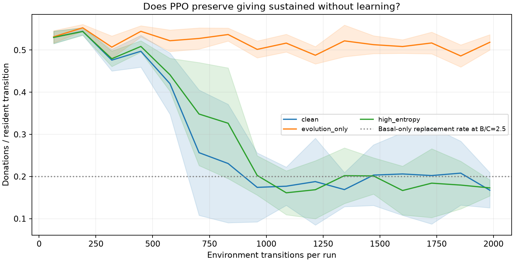
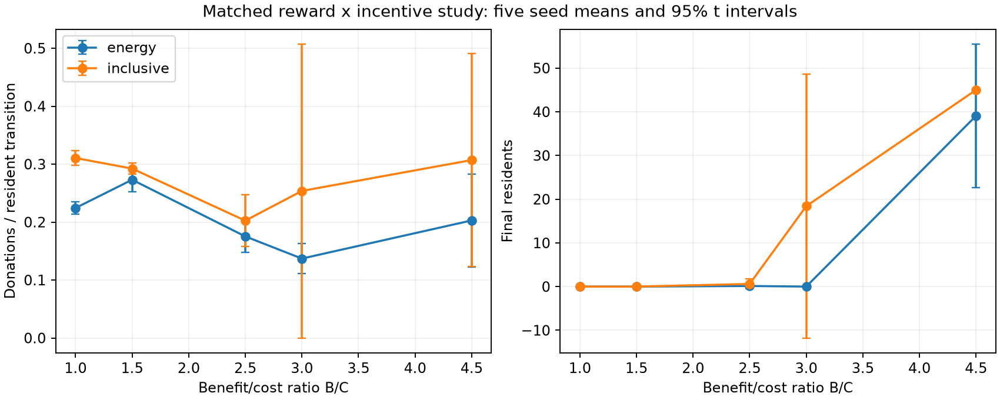
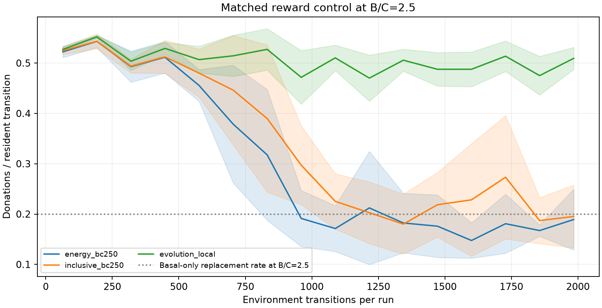

# Does private-reward learning preserve cooperation?

## Inherited policies, cue reliability, and spatial assortment in a donation game

CS329 Multi-Agent Systems | Group 21 | IIT Gandhinagar

Vansh Barfiwala (24110380), Pratham Choksi (24110275), Shubham Chandak (24110335)

## Abstract

We investigate whether individual energy-reward PPO preserves cooperation supported by inherited policies and survivor selection, and whether incentive alignment, cue reliability, and spatial placement alter the outcome. We complete evaluation of 95 existing checkpoints (19 conditions, five seeds) and add 65 new training runs: a two-objective by five-incentive factorial and a learning by placement control. The original clean PPO policies yield 0.1822 donations per resident transition and 0.00 final residents; selection without PPO yields 0.5056 and 45.00, respectively. In the new matched B/C=2.5 experiment, private and marker-weighted rewards yield donation rates of 0.1753 and 0.2025. We report uncertainty at the training-seed level. The experiments distinguish ecological cooperation, marker preference, reward shaping, and evolutionary kin selection; none is assumed equivalent.

## 1. Computational question and success criteria

**Primary question:** Does private energy optimization preserve, create, or suppress giving that an inherited-policy population sustains without PPO? **Mechanism questions:** Does adding marker-weighted social energy to the reward change this answer across five B/C ratios? Does local reproduction cause spatial assortment, and does that depend on learning? **Robustness question:** Do independently trained noise and mimic conditions change the full policy's dependence on genetic and behavioural information?

Sustained cooperation requires survival through 300 evaluation transitions and a late donation rate at least 0.1 per resident transition, with giving on at least half of the final 100 transitions, in every expected seed/world. Cue adaptation additionally requires maintained cooperation and evidence of changed full-policy sensitivity; a gate weight alone is insufficient. Spatial assortment requires a matched local-minus-random difference among surviving populations and a comparison with contemporaneous global similarity. Hamilton-style discrimination is explored with an interaction regression and a direct reward intervention, not inferred from survival alone. These are declared operational criteria for this analysis, not a preregistered protocol.

### Known and unknown information

| Quantity | Information available to the actor |
| --- | --- |
| Own state | Energy/E_mitosis and age/1000 |
| Neighbours | Up to eight nearest: relative position/radius, normalized energy, corrected genetic cue, donation history |
| Incentives and rules | Fixed by each training environment; B/C is not a numerical policy input |
| Hidden | True corruption probability, mimic identity, other networks and internal states |
| Trainer only | Family membership for assigning transitions; full energy vector for the explicitly shaped reward control |

## 2. One consistent model

A partially observed Markov game runs on a toroidal grid. Each living resident chooses stay (action 0), one of four cardinal moves (1-4), or a donation to an observed neighbour (5-12). Stay means no move and no donation; there is no separate request/refusal game. A donation is legal only when the donor has strictly more than C energy. Movements and donations are mutually exclusive. Recipients are resolved from the decision-time neighbourhood; movement conflicts are resolved before metabolic crowding is charged.

`Delta E_i = -c_base - c_density * |N_i(after movement)| - C * 1[give_i] + B * incoming_i`

The energy reward is recorded before mitosis. Death at energy <= 0 terminates that individual. A parent with energy >= 60 can place a child in a free adjacent cardinal cell if capacity and a free tensor slot exist. The parent and child each receive half the pre-split energy. If no legal cell exists, reproduction is skipped. The child receives a fresh persistent identity, a mutated eight-bit chromosome, the family policy, and history prior 0.5. Donation creates B-C net energy; only the reproduction split conserves parent-plus-child energy.

`h_ij = 1 - HammingDistance(c_i,c_j)/8`

`r_tilde_ij = max(0, (h_ij - h_bar) / max(1-h_bar, 1e-6))`

Here h is **similarity**, and h_bar is the distinct-active-pair population mean. This baseline correction uses population information computed by the simulator; the actor receives its result locally. The true chromosome determines assortment measurements; corrupted visible chromosomes determine the observed cue. Recent behaviour is the fraction of the neighbour's last ten actions that were donations **given**. The chromosome is a tag proxy and may be copied by mimics; it is not pedigree relatedness.

### Policy ownership and evolutionary selection

There are 24 independent founder networks and optimizers. Descendants share their founder family's network. PPO pools individual-return transitions within each family; unrelated founders never share optimizer updates. Individual returns terminate at death even if a newborn reuses the storage slot. At episode end, survivor restocking samples 24 living individuals with replacement and copies their genomes, networks, and optimizer states into independent next-generation founders. Thus selection weights families by surviving abundance. If all residents die, there is no winner; the last founder genomes and learned networks are retained for a new episode. Restocking reintroduces initial energy and is an explicit ecological intervention.

This resolves the proposal's ambiguous use of "independent PPO" and "shared parameters": the submitted formulation is **independent across founders and shared within descendant families**. The outer selection loop extends the proposal. Shared weights alone do not put a recipient's benefit in the donor's PPO return; selection and learning are distinct processes.

### Architecture and algorithm

A contextual gate uses each neighbour's cues plus masked neighbourhood means and standard deviations. The gated affinity and raw cues enter a 32-dimensional encoder and two-head attention. Five movement/stay logits and eight targeted-donation logits are concatenated and normalized in **one masked 13-action categorical distribution**. A local critic predicts individual return. A decentralized critic matches the individual objective; variable population size does not itself preclude a centralized attention critic.

```text
Initialize 24 independent family networks and genomes.
For each rollout:
  Observe active identities; sample legal actions from their family policies.
  Snapshot decision-time cues and identities; step movement, energy and demographics.
  Assign terminal death credit to old identities; bind each child to its parent family.
  Build individual-return GAE targets; update each family on its own samples.
  At episode end, restock from living residents if any; record extinction otherwise.
Freeze all policies for evaluation in fresh seeded worlds.
```

## 3. Experimental design

| Parameter | Value |
| --- | --- |
| Grid / founders / capacity | 18 x 18 torus / 24 / 45 |
| Initial energy / mitosis threshold | 30 / 60 |
| Basal / per-neighbour drain | 0.6 / 0.08 within Chebyshev radius 3 |
| Donation C / default B | 2 / 5 |
| Neighbour limit / history / initial prior | 8 / 10 / 0.5 |
| Chromosome / mutation | 8 bits / independent bit flips with probability 0.05 |
| Episode / evaluation horizon | 300 transitions |
| PPO rollout / epochs / minibatch | 64 transitions / 3 / 64 |
| Learning rate / gamma / GAE lambda | 0.0003 / 0.99 / 0.95 |
| Clip / value coefficient / entropy / gradient limit | 0.2 / 0.5 / 0.01 / 0.5 |
| New matched budget / seeds / worlds per seed | 2048 environment transitions / [42, 101, 202, 303, 404] / 3 |

The original 19-condition study includes architecture, noise, attack, selection, mutation, placement, optimizer and budget controls. Most use 2,048 transitions; the longer run uses 8,192. We complete its frozen evaluation without pretending it was retrained. Original training used PyTorch 2.5.1+cu121 and NumPy 2.3.2; evaluation and all new training use the separately recorded CPU runtime. All claims about reward changes use newly trained matched conditions on the same runtime. Original results and new results are displayed separately.

The new factorial crosses two objectives with B/C in {1, 1.5, 2.5, 3, 4.5}, holding C=2 and setting B=C*(B/C). Three extra conditions complete learning x offspring-placement comparisons at B/C=2.5: selection without PPO under local and random placement, and private-reward PPO with random placement. Each uses the same five seed blocks and three fresh worlds per checkpoint. Paired seeds reduce initialization variation; differing trajectories need not consume identical RNG draws.

The **marker-weighted inclusive reward control** is

`R_i = Delta E_i + sum_{j != i, acting at decision time} r_tilde_ij * Delta E_j`.

This intentionally changes the objective and supplies privileged social reward information to training. It uses decision-time masks and cues, excluding diagonal self-credit and inactive slots; death or birth cannot redirect old-identity rewards. It is an incentive diagnostic, not biological inclusive fitness. The original ecology and pre-mitosis energy deltas remain unchanged. For an isolated donor-recipient intervention with all other actions fixed, the immediate shaped reward difference is `-C + r_tilde_ij*B`; its zero lies at `r_tilde=1/(B/C)`. Thresholds across the five ratios are 1, 0.6667, 0.4, 0.3333 and 0.2222. At B/C=1, strict rB>C is impossible for r<=1; that is an informative boundary condition.

### Metrics and uncertainty

We report donations divided by acting-resident transitions, final resident count, full-horizon survival, late-window giving, donation share to mimics, recipient preference relative to available neighbours, and spatial similarity. World means are averaged **within training seed** before Student t intervals or paired contrasts. The effective sample size is five seed blocks, not fifteen worlds, 24 family networks, or thousands of recipient decisions. Survival events use Wilson intervals across seeds. Small-sample mean intervals can exceed physical bounds; these are exploratory intervals, not guaranteed coverage under all distributions.

Reward contrasts use exact paired sign-flip tests with Holm adjustment across five ratios. Five pairs give a minimum two-sided p of 0.0625, so these runs cannot establish conventional 5% significance with that test. Sign-flip validity assumes exchangeable signs of paired effects under the null; seed matching alone does not guarantee this assumption. Effect sizes and intervals are reported without equating a nonsignificant p with no effect. All-condition evaluation proceeds even after the original cooperation screen fails.

## 4. Results: completed original study

Clean sustained-cooperation screen passed: **False**.

| Condition / control | Final residents (95% interval) | Donations / resident transition (95% interval) | All worlds survive (seed proportion, Wilson interval) |
| --- | --- | --- | --- |
| Bc150 | 0.0000 [0.0000, 0.0000]; n=5 | 0.2655 [0.2526, 0.2783]; n=5 | 0.0000 [0.0000, 0.4345]; n=5 |
| Bc450 | 21.4000 [-5.1831, 47.9831]; n=5 | 0.1382 [0.0648, 0.2117]; n=5 | 0.4000 [0.1176, 0.7693]; n=5 |
| Dyadic Tit For Tat (rule) | 44.4000 [43.2894, 45.5106]; n=5 | 0.6477 [0.6267, 0.6686]; n=5 | 1.0000 [0.5655, 1.0000]; n=5 |
| Fixed Threshold (rule) | 27.0000 [-3.6039, 57.6039]; n=5 | 0.5928 [-0.0791, 1.2647]; n=5 | 0.6000 [0.2307, 0.8824]; n=5 |
| Reputation (rule) | 45.0000 [45.0000, 45.0000]; n=5 | 0.9855 [0.9829, 0.9881]; n=5 | 1.0000 [0.5655, 1.0000]; n=5 |
| Selfish (rule) | 0.0000 [0.0000, 0.0000]; n=5 | 0.0000 [0.0000, 0.0000]; n=5 | 0.0000 [0.0000, 0.4345]; n=5 |
| Tag Trust (rule) | 27.0000 [-3.6039, 57.6039]; n=5 | 0.5727 [-0.0766, 1.2220]; n=5 | 0.6000 [0.2307, 0.8824]; n=5 |
| Clean PPO | 0.0000 [0.0000, 0.0000]; n=5 | 0.1822 [0.1551, 0.2093]; n=5 | 0.0000 [0.0000, 0.4345]; n=5 |
| Untrained Ancestors | 45.0000 [45.0000, 45.0000]; n=5 | 0.5236 [0.5120, 0.5352]; n=5 | 1.0000 [0.5655, 1.0000]; n=5 |
| Evolution Only | 45.0000 [45.0000, 45.0000]; n=5 | 0.5056 [0.4827, 0.5285]; n=5 | 1.0000 [0.5655, 1.0000]; n=5 |
| Fallback | 24.0000 [24.0000, 24.0000]; n=5 | 0.3015 [0.2352, 0.3678]; n=5 | 1.0000 [0.5655, 1.0000]; n=5 |
| Fixed Gate | 0.0000 [0.0000, 0.0000]; n=5 | 0.1610 [0.1410, 0.1810]; n=5 | 0.0000 [0.0000, 0.4345]; n=5 |
| Fixed Noise Mimics | 38.1333 [26.4502, 49.8164]; n=5 | 0.3994 [0.3233, 0.4754]; n=5 | 1.0000 [0.5655, 1.0000]; n=5 |
| High Entropy | 0.0000 [0.0000, 0.0000]; n=5 | 0.1851 [0.1618, 0.2085]; n=5 | 0.0000 [0.0000, 0.4345]; n=5 |
| Long Training | 0.0000 [0.0000, 0.0000]; n=5 | 0.0745 [-0.0105, 0.1595]; n=5 | 0.0000 [0.0000, 0.4345]; n=5 |
| Low Lr | 45.0000 [45.0000, 45.0000]; n=5 | 0.5000 [0.4578, 0.5422]; n=5 | 1.0000 [0.5655, 1.0000]; n=5 |
| Mlp | 9.6000 [-8.5908, 27.7908]; n=5 | 0.2432 [0.1643, 0.3220]; n=5 | 0.4000 [0.1176, 0.7693]; n=5 |
| Mutation000 | 1.3333 [-0.7153, 3.3820]; n=5 | 0.2138 [0.1714, 0.2562]; n=5 | 0.0000 [0.0000, 0.4345]; n=5 |
| Mutation010 | 0.0000 [0.0000, 0.0000]; n=5 | 0.2075 [0.1986, 0.2164]; n=5 | 0.0000 [0.0000, 0.4345]; n=5 |
| Mutation020 | 0.3333 [-0.5921, 1.2588]; n=5 | 0.1900 [0.1537, 0.2262]; n=5 | 0.0000 [0.0000, 0.4345]; n=5 |
| No Selection | 12.2667 [3.4897, 21.0436]; n=5 | 0.3013 [0.2534, 0.3492]; n=5 | 0.8000 [0.3755, 0.9638]; n=5 |
| Noise025 | 0.0000 [0.0000, 0.0000]; n=5 | 0.1833 [0.1664, 0.2001]; n=5 | 0.0000 [0.0000, 0.4345]; n=5 |
| Noise050 | 1.2667 [-2.2502, 4.7835]; n=5 | 0.1867 [0.1426, 0.2309]; n=5 | 0.0000 [0.0000, 0.4345]; n=5 |
| Noise Mimics | 32.5333 [9.4193, 55.6474]; n=5 | 0.3926 [0.2593, 0.5259]; n=5 | 0.8000 [0.3755, 0.9638]; n=5 |
| Random Placement | 0.0000 [0.0000, 0.0000]; n=5 | 0.2011 [0.1799, 0.2223]; n=5 | 0.0000 [0.0000, 0.4345]; n=5 |

The fourfold training budget yields 0.0745 [-0.0105, 0.1595]; n=5 donations per resident transition and 0.0000 [0.0000, 0.0000]; n=5 final residents. The high-entropy control yields 0.1851 [0.1618, 0.2085]; n=5 and 0.0000 [0.0000, 0.0000]; n=5, respectively. These distinguish finite-budget and exploration effects; higher entropy can preserve diverse donation actions without demonstrating learned recipient discrimination.

The rule baselines demonstrate feasibility under the matched ecology; they do not establish that the neural objective finds the same strategies. Dyadic Tit-for-tat remembers directed encounters, while public reputation uses an individual's public donation history. The untrained-ancestor comparator restores initial neural weights but retains the trained founder chromosomes and ancestry composition; the evolution-only condition is the separate selection-without-PPO control. The static fallback disables birth/death and forces persistence; its survival count is not ecological success.



Curves are binned by actual environment transitions and weighted by resident exposure within each run; shaded regions are pointwise seed-level 95% t intervals. Rollout totals are apportioned to bins by temporal overlap, an approximation within each rollout. The dotted 0.2 line replaces basal drain only at B/C=2.5; crowding increases the required giving rate. It is not a learned decision threshold.

## 5. Results: matched reward x benefit/cost experiment

| Objective / B:C | Final residents (95% interval) | Donations / resident transition (95% interval) | Seed fraction surviving every world |
| --- | --- | --- | --- |
| energy / 1 | 0.0000 [0.0000, 0.0000]; n=5 | 0.2243 [0.2138, 0.2348]; n=5 | 0.0000 [0.0000, 0.4345]; n=5 |
| energy / 1.5 | 0.0000 [0.0000, 0.0000]; n=5 | 0.2731 [0.2528, 0.2934]; n=5 | 0.0000 [0.0000, 0.4345]; n=5 |
| energy / 2.5 | 0.1333 [-0.2369, 0.5035]; n=5 | 0.1753 [0.1475, 0.2031]; n=5 | 0.0000 [0.0000, 0.4345]; n=5 |
| energy / 3 | 0.0000 [0.0000, 0.0000]; n=5 | 0.1370 [0.1112, 0.1629]; n=5 | 0.0000 [0.0000, 0.4345]; n=5 |
| energy / 4.5 | 39.0667 [22.5931, 55.5402]; n=5 | 0.2028 [0.1227, 0.2830]; n=5 | 0.8000 [0.3755, 0.9638]; n=5 |
| inclusive / 1 | 0.0000 [0.0000, 0.0000]; n=5 | 0.3106 [0.2978, 0.3234]; n=5 | 0.0000 [0.0000, 0.4345]; n=5 |
| inclusive / 1.5 | 0.0000 [0.0000, 0.0000]; n=5 | 0.2923 [0.2829, 0.3018]; n=5 | 0.0000 [0.0000, 0.4345]; n=5 |
| inclusive / 2.5 | 0.6000 [-0.5106, 1.7106]; n=5 | 0.2025 [0.1576, 0.2475]; n=5 | 0.0000 [0.0000, 0.4345]; n=5 |
| inclusive / 3 | 18.4000 [-11.7676, 48.5676]; n=5 | 0.2538 [-0.0000, 0.5076]; n=5 | 0.4000 [0.1176, 0.7693]; n=5 |
| inclusive / 4.5 | 45.0000 [45.0000, 45.0000]; n=5 | 0.3070 [0.1235, 0.4906]; n=5 | 1.0000 [0.5655, 1.0000]; n=5 |



| B/C | Shaped minus private donation rate (paired 95% interval) | Exact paired p | Holm p |
| --- | --- | --- | --- |
| 1 | 0.0863 [0.0717, 0.1009]; n=5 | 0.0625 | 0.3125 |
| 1.5 | 0.0193 [0.0041, 0.0345]; n=5 | 0.1250 | 0.5000 |
| 2.5 | 0.0272 [-0.0403, 0.0948]; n=5 | 0.1875 | 0.5000 |
| 3 | 0.1167 [-0.1345, 0.3680]; n=5 | 0.3125 | 0.5000 |
| 4.5 | 0.1042 [-0.0253, 0.2337]; n=5 | 0.1250 | 0.5000 |

At the default B/C=2.5, the shaped objective increases mean giving relative to matched private PPO: 0.0272 [-0.0403, 0.0948]; n=5. The proportion of seed blocks surviving every fresh world is 0.00 for shaped reward and 0.00 for private reward. This is a measured incentive-control result at the declared budget. It does not validate the proposal's claim that private-reward policy sharing inherently values kin. Giving more and sustaining a population are separate outcomes; neither establishes biological kin selection. The finite budget and coarse marker reward remain possible limits on what the optimizer can discover.

At B/C=4.5, final resident counts are 39.0667 [22.5931, 55.5402]; n=5 under private reward and 45.0000 [45.0000, 45.0000]; n=5 under shaped reward. Their giving rates are 0.2028 [0.1227, 0.2830]; n=5 and 0.3070 [0.1235, 0.4906]; n=5, respectively. Survival is therefore sensitive to the resource benefit as well as the reward objective. Giving frequency need not increase monotonically with B/C. At B/C=1, donation creates no net energy, so positive giving alone cannot replace metabolic losses; both reward conditions become extinct. This boundary control separates the amount of giving from whether it is ecologically productive.



## 6. Results: spatial structure where survival is possible

| Condition | Final residents | Late adjacent similarity | Late global similarity | Late adjacent minus global similarity |
| --- | --- | --- | --- | --- |
| evolution_local | 45.0000 [45.0000, 45.0000]; n=5 | 0.6842 [0.6237, 0.7447]; n=5 | 0.6690 [0.6060, 0.7321]; n=5 | 0.0152 [0.0114, 0.0189]; n=5 |
| evolution_random | 45.0000 [45.0000, 45.0000]; n=5 | 0.6924 [0.6212, 0.7635]; n=5 | 0.6912 [0.6237, 0.7587]; n=5 | 0.0012 [-0.0054, 0.0078]; n=5 |
| energy_bc250 | 0.1333 [-0.2369, 0.5035]; n=5 | 0.6462 [CI unavailable]; n=1 | 0.6246 [CI unavailable]; n=1 | 0.0216 [CI unavailable]; n=1 |
| energy_random | 0.0000 [0.0000, 0.0000]; n=5 | undefined; n=0 | undefined; n=0 | undefined; n=0 |

| Local minus random placement | Paired late excess similarity | Paired donation rate |
| --- | --- | --- |
| evolution_local vs evolution_random | 0.0140 [0.0059, 0.0221]; n=5 | 0.0074 [-0.0072, 0.0219]; n=5 |
| energy_bc250 vs energy_random | undefined; n=0 | 0.0165 [-0.0176, 0.0506]; n=5 |

The learning-by-placement interaction in donation rate, `(PPO local - PPO random) - (evolution local - evolution random)`, is 0.0091 [-0.0158, 0.0341]; n=5.

Late statistics use the final 100 transitions and are undefined after extinction. Their n therefore reports the available surviving seed means; a paired spatial comparison requires defined measurements in both placements. The excess over global similarity controls for population-wide tag homogenization. This is spatial marker assortment, not a pedigree coefficient or a demonstrated evolutionary fitness advantage. The no-PPO comparison prevents an extinct learned population from making the spatial question empty.

## 7. Cue reliability and mimicry

| Original training condition | Genetic cue TV sensitivity | Behaviour cue TV sensitivity | Genetic gate weight |
| --- | --- | --- | --- |
| clean | 0.0060 [0.0012, 0.0108]; n=5 | 0.0091 [0.0037, 0.0145]; n=5 | 0.4680 [0.3193, 0.6167]; n=5 |
| fixed_noise_mimics | 0.0039 [-0.0007, 0.0084]; n=5 | 0.0091 [-0.0029, 0.0212]; n=5 | 0.5000 [0.5000, 0.5000]; n=5 |
| noise025 | 0.0040 [0.0015, 0.0064]; n=5 | 0.0086 [0.0048, 0.0124]; n=5 | 0.3080 [0.1707, 0.4452]; n=5 |
| noise050 | 0.0043 [0.0037, 0.0049]; n=5 | 0.0081 [0.0045, 0.0118]; n=5 | 0.3645 [0.1956, 0.5334]; n=5 |
| noise_mimics | 0.0029 [0.0020, 0.0037]; n=5 | 0.0067 [0.0013, 0.0120]; n=5 | 0.3895 [0.1570, 0.6220]; n=5 |

TV is total variation between the complete action distributions on identical synthetic inputs before and after permuting one cue. Raw cues also enter the encoder, so gate weights cannot identify reliance. These probes cover both paths but can leave the realistic observation manifold; they are descriptive sensitivity tests.

| Attacked condition | Donation share to mimics | Post-invasion donation count |
| --- | --- | --- |
| noise_mimics | 0.2263 [0.1683, 0.2843]; n=5 | 13796 |
| fixed_noise_mimics | 0.2703 [0.2369, 0.3037]; n=5 | 10154 |

Mimics enter at transition 10, copy the most common resident tag, remain stationary, and never donate. Mimic donation shares condition on actual post-invasion giving; no giving yields an undefined share, never successful defense. Because clean cooperation is a prerequisite, changes under noise or mimicry cannot be called successful adaptive trust when the learned ecology collapses.

## 8. Hamilton association and objective intervention

`logit P(give to j) = beta0 + beta_r*r + beta_b*b + beta_q*(B/C) + beta_rq*r*(B/C) + beta_n*available_neighbors + beta_E*own_energy`

The corrected model includes the missing tag-by-incentive interaction and five independently trained incentive levels. It records only legal recipient opportunities, includes competition among available targets, and fits each objective separately. Uniform outcome-blind reservoirs retain at most 4,000 opportunities per world, followed by a cap of 12,000 per seed for fitting. Recipient decisions are dependent; cluster sandwich intervals use the five training-seed blocks. This small-cluster regression is exploratory and does not estimate causal pedigree fitness. B/C is a training condition, not an actor input, so coefficients cannot be read as an instantaneous actor response to an observed B/C value.

| Objective | Fit status | Tag x B/C coefficient and cluster interval | Pseudo-R2 | Seed clusters / opportunities |
| --- | --- | --- | --- | --- |
| energy | exploratory fit | -0.0809 [-0.4108, 0.2491] | 0.0198 | 5 / 60000 |
| inclusive | exploratory fit | 0.0160 [-0.1193, 0.1513] | 0.0228 | 5 / 60000 |

The matched one-transition environment intervention gives donor reward difference -2.0000 and recipient difference 5.0000. Thus private reward immediately prices giving at -C; the shaped two-agent control prices it at -C+rB. This directly tests reward plumbing. It is separate from whether learned long-horizon actions follow that threshold, and neither test validates biological Hamilton's rule.

## 9. Interpretation and limitations

Individual PPO and evolutionary selection act on different signals. Giving's immediate private cost is assigned to the donor, while another resident's benefit is not directly in its return. Delayed reciprocity can still make giving privately beneficial, but it must be discovered under partial observations, moving neighbours, terminal death, and nonstationary family policies. The negative learning comparison is scientifically informative: ecological feasibility does not imply that a private-return optimizer learns a cooperative rule. Untrained policies have many possible donation actions, so their survival is not learned altruism. Selection without PPO is likewise not proof of kin discrimination.

Summing pre-demographic energy changes yields `(B-C)*D - c_base*N - c_density*sum_i |N_i|`, where D is the donation count. At the default B-C=3, fewer than 0.2 donations per resident transition cannot replace even basal energy loss. Crowding raises that threshold. The plotted collapse in giving therefore has a concrete ecological consequence, but this energy balance alone cannot identify why PPO chose those actions.

For a trajectory without reproduction, the private discounted energy sum telescopes to `sum_t gamma^t Delta E_t = -E_0 + (1-gamma)*sum_(t=1 to T-1) gamma^(t-1)*E_t + gamma^(T-1)*E_T`. At gamma=1 it reduces to terminal minus initial energy; at gamma=0.99 it also values earlier stored energy. There is no direct descendant-fitness term. Reproduction adds bookkeeping terms because reward precedes the split, so this identity is deliberately restricted to trajectories without reproduction. It does not prove that giving is privately suboptimal: later reciprocity can still improve individual return.

The main limits are five seeds, short finite training budgets, one base ecology, eight-bit marker proxies, restocking energy, and a privileged shaped reward. The original one-factor controls and new reward/incentive factorial do not span all interactions. Noise/mimic effects are measured under trajectories that may go extinct; late assortment is reported only where defined. Pointwise learning intervals are not simultaneous bands. Regression samples are dependent and small-cluster intervals can be unreliable. Evaluation on a newer CPU runtime may alter sampled trajectories even with the same seed; the original training provenance and replay runtime are both retained. No finite negative experiment proves that cooperation is impossible, and a successful explicitly shaped reward would not establish spontaneous kin selection.

The browser simulation still runs the earlier single shared-policy checkpoint; it is an illustration, not an execution or replay of the new inherited-family experiment. The report, raw world results, and saved policies are the evidence for the submission. Historical demographic and descendant-reward variants are retained separately and are not pooled into these results.

## 10. Reproducibility

We verify 95 original and 65 new checkpoint files against their recorded SHA256 values and original archived training sources. Actor and environment source must match the trained architecture/ecology byte for byte; evaluation versions and source hashes are recorded separately. Archive line endings are preserved in Git so Windows checkout cannot silently corrupt source hashes. Original checkpoint metadata and claimed training versions are never rewritten to pass a replay check.

```powershell
python -m pip install -r requirements.txt
python experiments/mechanism_study.py --steps 2048 --workers 3
python evaluation/complete_study.py --study-dir results/submission_study --workers 3
python evaluation/complete_study.py --study-dir results/mechanism_study --workers 3
python evaluation/submission_report.py
python -m pytest -q
node --test tests/web_simulation.test.cjs
python -m pip install -r requirements-report.txt
python evaluation/export_submission.py
```

New training refuses to overwrite incompatible files; matching completed runs are checked before reuse. Training and evaluation run in separate worker processes to isolate PyTorch RNG state. The full provenance manifest includes checkpoints, source archives, summaries, diagnostics, and figures. Exact package versions for this execution are recorded alongside each analysis.

- [Original study results](../results/submission_study/results.md) and [raw worlds](../results/submission_study/analysis.json).
- [New study results](../results/mechanism_study/results.md), [raw worlds](../results/mechanism_study/analysis.json), and [diagnostics](../results/mechanism_study/diagnostics.json).
- [Complete model and execution protocol](final_study_protocol.md).

## 11. Proposal corrections and scope

The final study replaces the unproven title claim of emergent kin selection with a testable cooperation question. It resolves independent versus shared PPO, specifies all parameters, fixes the free-slot rule, defines affordability and stay, normalizes all actions jointly, and separates donation energy creation from mitosis conservation. It measures full-policy cue sensitivity, uses a tag-by-B/C interaction, tests five incentive levels, and measures late assortment in surviving selection-only populations. The privileged reward control is explicitly outside the original private-energy objective. These changes make the mechanism and the scope of the conclusions reviewable.

The project matches the course sequence: decision problem, model, algorithm, implementation, quantitative evaluation, and limitations. The rubric does not require a positive hypothesis result; the contribution is a reproducible investigation of when private learning and survivor selection diverge.

## Team responsibilities and background

The proposal assigns environment and demographics to Vansh Barfiwala, cues and attention to Pratham Choksi, and PPO and evaluation to Shubham Chandak. These are the team's stated areas of responsibility.

Biological background: Hamilton (1964), The genetical evolution of social behaviour, Parts I and II; Dawkins (1976), The Selfish Gene. MARL background from the proposal: Leibo et al. (2017), Multi-agent reinforcement learning in sequential social dilemmas; Hughes et al. (2018), Inequity aversion improves cooperation in intertemporal social dilemmas; Jaques et al. (2019), Social influence as intrinsic motivation for multi-agent deep reinforcement learning; Lupu and Precup (2020), Gifting in multi-agent reinforcement learning. Dawkins supplies biological context and is not cited as MARL research.
