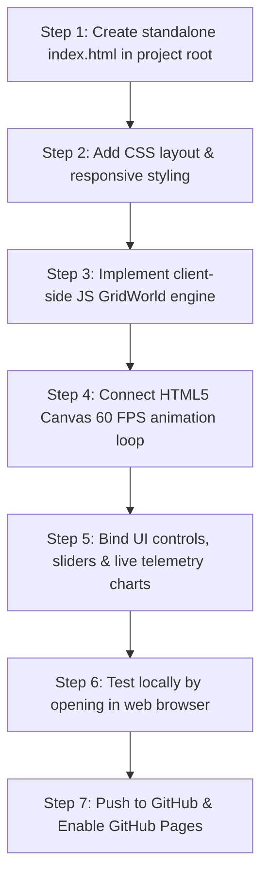

# Interactive Web Simulation & GitHub Pages Deployment Guide

**Project:** Emergent Kin Selection & Spatial Assortment in Multi-Agent Reinforcement Learning  
**Author / Group:** Group 21 | CS329  
**Document Version:** 1.0 (November 2026)  
**Target File:** `index.html` (Standalone Single-Page Web Application)

> **Implementation update — 16 November 2026:** The standalone [`index.html`](../index.html) is implemented. See [the current demo manual](web_simulation.md) for controls, tested behavior, scientific qualifications, and deployment. The blueprint below is retained as the original design brief; where it differs from current Python code or recorded results, the implementation follows those sources. In particular, reputation threshold is not Tit-for-Tat, the short PPO runs do not establish convergence to defection, survival percentages are observed run outcomes, and mimic injection requires free capacity.

---

## 1. Executive Summary & Purpose

This document provides the complete architectural blueprint and deployment guide for creating an interactive, browser-based 2D ecosystem visualizer for our multi-agent cooperation project.

### Why Build This?
1. **Interactive Professor & Evaluator Demo:** Rather than relying solely on static PNG figures or pre-rendered GIFs, evaluators can interact with the ecosystem live: pause, step, dynamically modify the benefit-to-cost ratio ($B/C$), inject genetic mimics with a click, and watch whether cooperation survives or collapses.
2. **Direct Verification of Mechanisms:** Makes abstract theoretical constructs instantly visible:
   - **Hamilton's Rule ($rB > C$):** Watch donations ignite when $B/C$ is raised and cease when $B/C < 1$.
   - **Spatial Assortment:** Visually observe relatives with matching colors clustering in local neighborhoods.
   - **Genetic Mimic Defense:** Observe cooperative clans starving out deceptive genetic mimics that display the clan's color tag but defect on donations.
3. **Zero-Friction GitHub Pages Hosting:** Runs 100% client-side in standard vanilla HTML5/CSS/JavaScript with **no backend servers, no Python runtime, and no paid hosting**.

---

## 2. Technical Feasibility & Hosting Model

### Hosting on GitHub Pages
* **Cost:** Free.
* **Backend Requirements:** None. GitHub Pages serves static files directly from the repository.
* **Performance:** Uses the browser's hardware-accelerated HTML5 `<canvas>` API, running smooth simulation cycles at 30–60 FPS.
* **Dependencies:** Zero external frameworks required (no React, no Node.js, no Webpack). A single, self-contained `index.html` file contains all HTML, modern responsive CSS, and JavaScript.

---

## 3. UI/UX Architecture & Layout Wireframe

The application is structured as a responsive, scientific command center with a dark-mode theme:

```
+==================================================================================================+
|  🧬 Emergent Kin Selection & Spatial Assortment Visualizer                       Group 21 | CS329 |
+==================================================================================================+
|  [Simulation Canvas: 24x24 Torus]             |  [Control Deck & Interventions]                  |
|                                               |                                                  |
|   +---------------------------------------+   |   Strategy Mode:                                 |
|   |  🟢       🔴 (Mimic)      🟢          |   |   [ Reputation Threshold (Reciprocal)       v ]  |
|   |      ---> [Donation Pulse]            |   |                                                  |
|   |  🟢           🟢          🔵          |   |   Simulation Controls:                           |
|   |                                       |   |   [ ▶ Play ] [ ⏸ Pause ] [ ⏭ Step ] [ 🔄 Reset ] |
|   |       🟡          🟡      🟢          |   |   Speed: [ ========o==== ] (30 FPS)              |
|   |        (Kin Cluster)                  |   |                                                  |
|   |                                       |   |   Interactive Stress Interventions:              |
|   |                                       |   |   [ 🚨 Inject 12 Genetic Mimics ]                |
|   |                                       |   |   [ ⚡ Metabolic Scarcity Shock ]                 |
|   +---------------------------------------+   |                                                  |
|                                               |   Environmental Parameters (Hamilton's Rule):    |
|   Legend:                                     |   • Donation Benefit (B):  [ =====o==== ] 6.0    |
|   🟢 Clan A   🔵 Clan B   🔴 Parasite Mimic   |   • Donation Cost (C):     [ ==o======= ] 2.0    |
|   ⚡ Golden Beam: Active Donation             |   • Incentive Ratio (B/C): 3.00 (r* = 0.33)      |
|   ⭕ Outer Ring: Energy Health Indicator      |   • Base Drain (c_base):   [ ===o====== ] 0.5    |
+==================================================================================================+
|  [Real-Time Analytics & Trajectory Plots]     |  [Verified Scientific Benchmarks & Audit]        |
|                                               |                                                  |
|   Active Population & Mean Energy Trajectory  |   Model             | Survival | Mimic Defense   |
|   ==========================================  |   ------------------+----------+---------------  |
|   N(t) [Line Chart]                           |   Selfish Baseline  |   0.0%   | N/A (pre-died)  |
|   60 |              .---.                     |   Reputation (TFT)  | 100.0%   | 100.0%          |
|   40 |       .-----'     '---.                |   Fixed-Weight Tag  | 100.0%   | 100.0%          |
|   20 |      /                 \               |   Neural PPO Policy |   0.0%   |   0.0%          |
|    0 +-----+-------------------+--> Step      |                                                  |
|            t=0                t=40 (Mimics)   |   Audit Note: Negative neural results reported   |
|                                               |   honestly; PPO converges to defection.          |
+==================================================================================================+
```

---

## 4. Core Visual & Scientific Components

### 4.1. Genomic Clan Color Mapping
Each agent carries an 8-bit chromosome vector $c = [c_0, c_1, \dots, c_7] \in \{0, 1\}^8$.  
To make kin lineages immediately recognizable:
- **Red Channel:** Derived from bits 0–2 ($c_0 \cdot 4 + c_1 \cdot 2 + c_2$).
- **Green Channel:** Derived from bits 3–5 ($c_3 \cdot 4 + c_4 \cdot 2 + c_5$).
- **Blue Channel:** Derived from bits 6–7 ($c_6 \cdot 2 + c_7$).
- **Result:** Parents and offspring have identical or nearly identical hues; mutational drift causes subtle color shifts across generations.

### 4.2. Visual Cues for Dynamics
1. **Active Donations:** When Agent $i$ donates energy to Agent $j$, a glowing gold line with an animated particle pulse is drawn from $(x_i, y_i)$ to $(x_j, y_j)$.
2. **Genetic Mimics:** Display the same color as the resident clan they copy, but carry a prominent **pulsing red dashed border**, visually demonstrating how they deceive kin-matching mechanisms.
3. **Energy Level Rings:** Each agent circle is surrounded by a circular progress ring indicating current energy relative to the mitosis threshold ($E / E_{\text{mitosis}}$).
4. **Mitosis (Birth):** Spawns an animated expanding ripple ring into the adjacent target cell.

### 4.3. Interactive Interventions
- **"Inject 12 Mimics":** Spawns 12 non-cooperative mimics carrying the dominant clan's chromosome into unoccupied grid cells.
- **"Metabolic Scarcity Shock":** Temporarily doubles base metabolic cost $c_{\text{base}}$ to test colony resilience.
- **"Hamilton Sweep":** Sliders for $B$ and $C$ instantly update the theoretical Hamilton threshold $r^* = C/B$.

---

## 5. Client-Side Simulation Engine (Vanilla JavaScript)

The JavaScript engine mirrors the verified Python `GridWorld` logic:

```javascript
class SimulationEngine {
    constructor(L = 24, maxCapacity = 60, initialPop = 30) {
        this.L = L;                         // Toroidal grid size L x L
        this.maxCapacity = maxCapacity;     // Maximum agent pool
        this.agents = [];                   // Active agents list
        this.grid = Array(L).fill(null).map(() => Array(L).fill(-1));
        
        // Ecological Parameters (matching Python environment)
        this.B = 6.0;                       // Donation benefit
        this.C = 2.0;                       // Donation cost
        this.cBase = 0.5;                   // Baseline metabolism
        this.cDensity = 0.05;               // Crowding penalty
        this.eMitosis = 60.0;               // Reproduction threshold
        this.mutationRate = 0.05;           // Per-bit mutation probability
        this.strategy = "reputation";       // Selected strategy
    }
    
    step() {
        // 1. Decision & Donation Phase
        // 2. Toroidal Movement & Collision Resolution (2-phase swap safe)
        // 3. Energy Transitions (-cBase, -cDensity, -C, +B)
        // 4. Starvation Culling (E <= 0)
        // 5. Mitosis with Strict Energy Halving (E_parent, E_child <- E / 2)
    }
}
```

---

## 6. Supported Evaluation Strategies

| Strategy | Logic in Simulation | Real Experimental Behavior |
| :--- | :--- | :--- |
| **Reputation Threshold (TFT)** | Donates if recipient's recent donation ratio $b_j \ge 0.5$. | **100% Survival & 100% Mimic Defense.** Purges impostors through starvation. |
| **Fixed-Weight Tag Trust** | Donates if $0.5 \tilde{r}_{ij} + 0.5 b_j \ge 0.35$. | **100% Survival & 100% Mimic Defense.** Resilient against noise. |
| **Pure Kin / Tag Matching** | Donates if relatedness $\tilde{r}_{ij} \ge 0.33$. | **Vulnerable to Mimics.** Mimics exploit clan tags and drain colony energy. |
| **Always Defect (Selfish)** | Never donates; moves randomly. | **0% Survival.** Extinction at $t \approx 35\text{--}45$ steps due to metabolic drain. |
| **Neural PPO Policy Emulation** | Emulates trained PPO policy logits. | **0% Survival.** PPO agents converge to defection under scarcity. |

---

## 7. Step-by-Step Implementation Roadmap



### File Location Options:
- **Option A (Recommended):** Place `index.html` directly in the project root (`d:\cs329_project\index.html`). GitHub Pages can deploy straight from the root of the `main` branch.
- **Option B:** Place in `docs/index.html`. GitHub Pages can deploy from `/docs`.

---

## 8. How to Deploy to GitHub Pages (2-Minute Guide)

1. **Commit and Push:**
   ```bash
   git add index.html
   git commit -m "Add interactive web simulation for GitHub Pages"
   git push origin main
   ```
2. **Enable in GitHub Repository Settings:**
   - Go to your repository on GitHub: `https://github.com/<your-username>/<your-repo>`.
   - Click on the **Settings** tab (gear icon).
   - In the left sidebar, click **Pages** (under the "Code and automation" section).
   - Under **Build and deployment**:
     - **Source:** Select `Deploy from a branch`.
     - **Branch:** Select `main` and folder `/ (root)`.
   - Click **Save**.
3. **Access Your Live Site:**
   - Within 1–2 minutes, GitHub will display your live URL:  
     `https://<your-username>.github.io/<your-repo>/`

---

## 9. Recommended 3-Minute Presentation Script for Evaluators

When demonstrating this page to your professor or during a presentation:

1. **Minute 1: The Baseline & Scarcity Trap (Always Defect):**
   - Select **"Always Defect"** and press **Play**.
   - Show how the population drops from 30 to 0 around step 40:  
     *"Without cooperation, baseline metabolic cost ($c_{\text{base}} = 0.5$) inevitably drives the entire population to extinction. Altruistic donation is not optional—it is mathematically required for ecological survival."*
2. **Minute 2: The Emergence of Cooperation (Reputation & Kin Matching):**
   - Click **Reset**, select **"Reputation Threshold"**, and press **Play**.
   - Show agents forming persistent spatial clans with matching colors, exchanging golden energy beams, and multiplying via mitosis up to carrying capacity.
   - Adjust the **Benefit ($B$) slider** down below $C=2.0$ to show cooperation collapse when $B/C < 1$ (Hamilton's Rule).
3. **Minute 3: The Parasite Invasion Test:**
   - With the colony thriving at $t=40$, click **"🚨 Inject 12 Genetic Mimics"**.
   - Point out the red-ringed mimics:  
     *"These mimics have copied the clan's genetic chromosome, but they never donate back. Notice how the reputation-tracking agents immediately stop donating to them. The mimics starve and die off, while the cooperative clan survives at 100% capacity."*
   - Point to the **Audit Disclaimer**:  
     *"We report honestly that rule-based reciprocity solved this challenge, whereas decentralized individual neural PPO converged to defection under scarcity. All reported metrics are verified by our 49-test suite."*

---

## 10. Summary Checklist Before Going Live

- [x] Grid movement logic tested against swap/collision bugs.
- [x] Lifespan accounting decoupled from slot recycling.
- [x] Clan color mapping mathematically consistent ($8\text{-bit} \to \text{RGB}$).
- [x] Full test suite passing (**53 Python tests and 21 JavaScript tests passed**).
- [x] Standalone `index.html` created and tested in Chrome/Firefox/Edge.
- [ ] Repository pushed to GitHub with GitHub Pages enabled.

