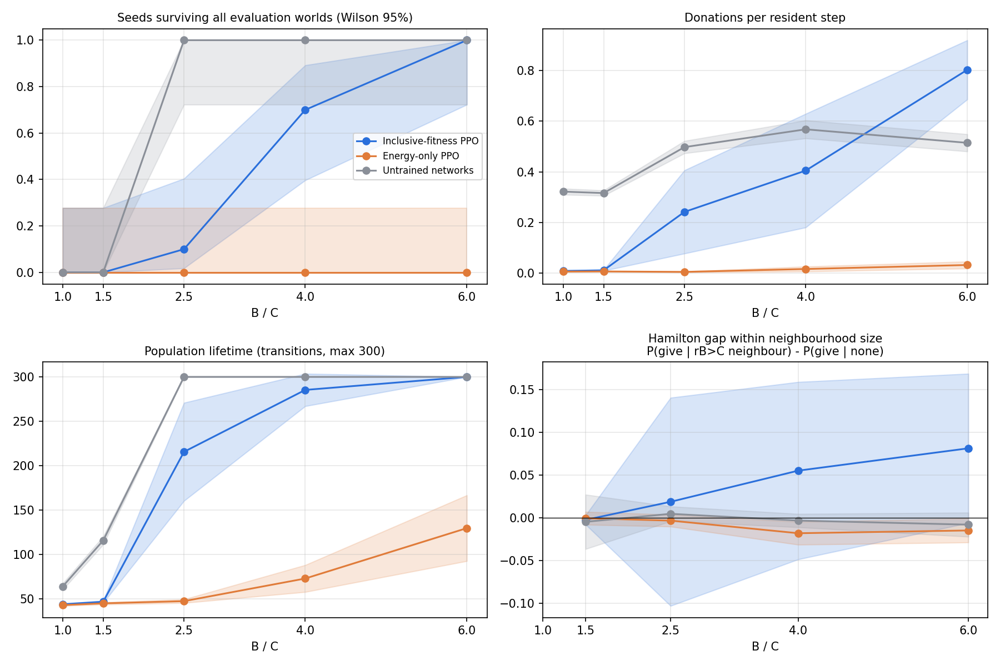
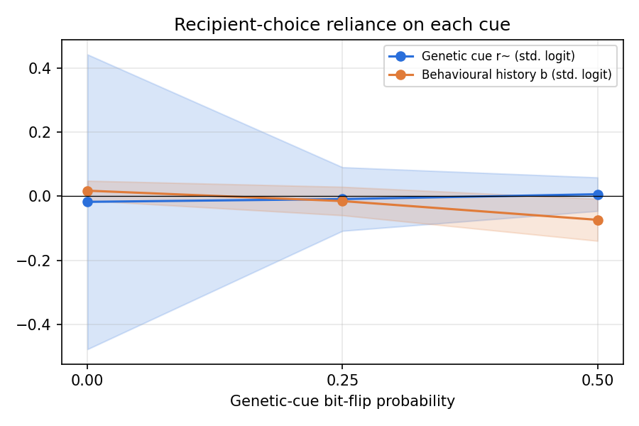

# Hamilton's-rule study: results

Generated by `evaluation/hamilton_report.py`. 8192 environment transitions per run, 10 training seeds, 3 fresh evaluation worlds per seed (averaged within seed). Brackets: 95% Student-t interval over training seeds (n = 10). Bounded metrics can have intervals outside their range.

## 1. B/C sweep (trained policies, clean worlds)

| B/C | Reward | Donations / resident step | Lifetime (of 300) | Final residents | Hamilton gap | Hamilton-consistent gifts |
| --- | --- | --- | --- | --- | --- | --- |
| 1.0 | energy | 0.006 [0.005, 0.007] | 42.7 [41.8, 43.6] | 0.0 [0.0, 0.0] | undefined | 0.000 [0.000, 0.000] |
| 1.0 | inclusive | 0.009 [0.006, 0.011] | 43.6 [42.6, 44.6] | 0.0 [0.0, 0.0] | undefined | 0.000 [0.000, 0.000] |
| 1.5 | energy | 0.007 [0.006, 0.008] | 44.7 [43.4, 45.9] | 0.0 [0.0, 0.0] | 0.001 [-0.004, 0.006] | 0.036 [0.022, 0.051] |
| 1.5 | inclusive | 0.011 [0.009, 0.013] | 46.5 [45.2, 47.7] | 0.0 [0.0, 0.0] | 0.002 [-0.003, 0.007] | 0.035 [0.003, 0.067] |
| 2.5 | energy | 0.005 [0.003, 0.007] | 47.1 [45.1, 49.2] | 0.0 [0.0, 0.0] | -0.002 [-0.005, 0.002] | 0.306 [0.074, 0.539] |
| 2.5 | inclusive | 0.242 [0.078, 0.406] | 215.5 [160.2, 270.8] | 4.7 [-5.5, 14.8] | 0.040 [-0.081, 0.160] | 0.316 [0.136, 0.495] |
| 4.0 | energy | 0.016 [0.007, 0.026] | 72.7 [57.5, 87.9] | 0.0 [0.0, 0.0] | -0.003 [-0.008, 0.003] | 0.205 [0.101, 0.309] |
| 4.0 | inclusive | 0.405 [0.180, 0.629] | 285.3 [267.0, 303.6] | 32.0 [17.0, 47.0] | 0.095 [-0.014, 0.203] | 0.499 [0.406, 0.592] |
| 6.0 | energy | 0.032 [0.018, 0.046] | 129.5 [92.4, 166.6] | 0.0 [0.0, 0.0] | 0.005 [-0.008, 0.017] | 0.395 [0.292, 0.497] |
| 6.0 | inclusive | 0.803 [0.686, 0.920] | 300.0 [300.0, 300.0] | 45.0 [45.0, 45.0] | 0.137 [0.053, 0.221] | 0.500 [0.438, 0.562] |

### 1b. Seeds whose trained population survived every evaluation world (Wilson 95%)

| B/C | Inclusive-fitness PPO | Energy-only PPO | Untrained networks (inclusive runs) |
| --- | --- | --- | --- |
| 1.0 | 0/10 [0.00, 0.28] | 0/10 [0.00, 0.28] | 0/10 [0.00, 0.28] |
| 1.5 | 0/10 [0.00, 0.28] | 0/10 [0.00, 0.28] | 0/10 [0.00, 0.28] |
| 2.5 | 1/10 [0.02, 0.40] | 0/10 [0.00, 0.28] | 10/10 [0.72, 1.00] |
| 4.0 | 7/10 [0.40, 0.89] | 0/10 [0.00, 0.28] | 10/10 [0.72, 1.00] |
| 6.0 | 10/10 [0.72, 1.00] | 0/10 [0.00, 0.28] | 10/10 [0.72, 1.00] |

## 2. Primary contrast: inclusive minus energy-only (paired by seed)

| B/C | Metric | Difference | Seeds positive | Exact sign-flip p | Holm p |
| --- | --- | --- | --- | --- | --- |
| 1.0 | donations_per_resident_step | 0.002 [0.000, 0.005] | 7/10 | 0.0410 | 0.0820 |
| 1.0 | duration | 0.900 [0.029, 1.771] | 7/10 | 0.0625 | 0.0820 |
| 1.5 | donations_per_resident_step | 0.005 [0.002, 0.007] | 10/10 | 0.0020 | 0.0195 |
| 1.5 | duration | 1.800 [0.562, 3.038] | 8/10 | 0.0078 | 0.0234 |
| 2.5 | donations_per_resident_step | 0.237 [0.072, 0.402] | 10/10 | 0.0020 | 0.0195 |
| 2.5 | duration | 168.400 [112.467, 224.333] | 10/10 | 0.0020 | 0.0195 |
| 4.0 | donations_per_resident_step | 0.388 [0.165, 0.612] | 10/10 | 0.0020 | 0.0195 |
| 4.0 | duration | 212.633 [191.918, 233.349] | 10/10 | 0.0020 | 0.0195 |
| 6.0 | donations_per_resident_step | 0.771 [0.655, 0.887] | 10/10 | 0.0020 | 0.0195 |
| 6.0 | duration | 170.533 [133.428, 207.639] | 10/10 | 0.0020 | 0.0195 |

With 10 pairs the smallest attainable two-sided sign-flip p is 0.001953. The pooled contrast below averages each seed over all five B/C levels.

Pooled over B/C (per-seed mean of the five levels): donation difference 0.281 [0.212, 0.349], 10/10 seeds positive, sign-flip p = 0.0020.

### 2b. Stacked tests over all independently trained runs

Each (B/C, seed) training run is independent, so the 50 inclusive-minus-energy pairs can be stacked.

| Metric | Pairs with inclusive > energy | Exact binomial sign test p |
| --- | --- | --- |
| donations_per_resident_step | 47/50 | 3.71e-11 |
| duration | 45/50 | 1.34e-12 |

| B/C levels | Inclusive runs surviving | Energy-only runs surviving | Fisher exact p |
| --- | --- | --- | --- |
| all B/C | 18/50 | 0/50 | 1.18e-06 |
| B/C >= 4 | 17/20 | 0/20 | 2.57e-08 |

## 3. Hamilton regression (decision level, cluster bootstrap over seeds)

logit P(choose j) = b0 + b1 r~ + b2 b + b3 (B/C) + b4 r~ x (B/C). Hamilton's rule predicts b4 > 0.

| Reward | Coefficient | Estimate | 95% bootstrap CI | Bootstrap share > 0 |
| --- | --- | --- | --- | --- |
| inclusive | intercept | -4.510 | [-4.734, -4.365] | 0.00 |
| inclusive | r_obs | 1.188 | [0.719, 1.474] | 1.00 |
| inclusive | b | 0.889 | [0.470, 1.129] | 1.00 |
| inclusive | bc | 0.298 | [0.255, 0.377] | 1.00 |
| inclusive | r_obs_x_bc | -0.172 | [-0.220, -0.091] | 0.00 |
| energy | intercept | -6.672 | [-7.086, -6.337] | 0.00 |
| energy | r_obs | -0.659 | [-1.816, 0.231] | 0.08 |
| energy | b | 0.481 | [-0.103, 0.936] | 0.94 |
| energy | bc | 0.403 | [0.302, 0.485] | 1.00 |
| energy | r_obs_x_bc | 0.049 | [-0.119, 0.250] | 0.71 |

This pooled model mixes the decision to give with the choice of recipient, and the raw Hamilton gap is confounded by neighbourhood size. The two analyses below remove each confound.

### 3a. Recipient choice given a gift (conditional logit, cluster bootstrap over seeds)

P(j | gift) proportional to exp(c1 r~ + c2 b + c3 E_j + c4 r~ x (B/C)). Hamilton's rule predicts c4 > 0.

| Reward | Coefficient | Estimate | 95% bootstrap CI | Bootstrap share > 0 |
| --- | --- | --- | --- | --- |
| inclusive | r_obs | 1.722 | [0.775, 2.664] | 1.00 |
| inclusive | b | 0.050 | [-0.030, 0.162] | 0.90 |
| inclusive | energy_j | 0.020 | [0.010, 0.027] | 1.00 |
| inclusive | r_obs_x_bc | -0.261 | [-0.420, -0.097] | 0.00 |
| energy | r_obs | 0.225 | [-1.162, 1.331] | 0.57 |
| energy | b | -0.797 | [-1.273, -0.259] | 0.00 |
| energy | energy_j | -0.042 | [-0.388, 0.350] | 0.40 |
| energy | r_obs_x_bc | -0.090 | [-0.297, 0.143] | 0.27 |

### 3b. Hamilton gap within neighbourhood size (Mantel-Haenszel, sampled opportunities)

Untrained networks give more often when more neighbours are visible, so the raw gap is positive even for them. The stratified gap compares opportunities with the same number of neighbours.

| B/C | Reward | Trained | Untrained networks | Trained - untrained (paired) | Seeds positive |
| --- | --- | --- | --- | --- | --- |
| 1.0 | energy | undefined | undefined | undefined | 0/0 |
| 1.0 | inclusive | undefined | undefined | undefined | 0/0 |
| 1.5 | energy | -0.001 [-0.008, 0.007] | -0.005 [-0.037, 0.027] | 0.004 [-0.027, 0.036] | 4/10 |
| 1.5 | inclusive | -0.002 [-0.008, 0.003] | -0.005 [-0.037, 0.027] | 0.002 [-0.029, 0.034] | 5/10 |
| 2.5 | energy | -0.003 [-0.010, 0.004] | 0.001 [-0.017, 0.019] | -0.001 [-0.022, 0.019] | 3/8 |
| 2.5 | inclusive | 0.019 [-0.103, 0.140] | 0.005 [-0.004, 0.013] | 0.013 [-0.107, 0.133] | 2/8 |
| 4.0 | energy | -0.018 [-0.031, -0.005] | 0.009 [-0.004, 0.023] | -0.028 [-0.055, -0.001] | 2/8 |
| 4.0 | inclusive | 0.055 [-0.049, 0.159] | -0.003 [-0.011, 0.005] | 0.058 [-0.044, 0.161] | 6/10 |
| 6.0 | energy | -0.015 [-0.029, -0.001] | 0.003 [-0.008, 0.013] | -0.017 [-0.037, 0.002] | 3/10 |
| 6.0 | inclusive | 0.081 [-0.006, 0.168] | -0.008 [-0.022, 0.006] | 0.089 [-0.000, 0.179] | 7/10 |

## 4. Cue reliability (inclusive reward, B/C = 2.5)

| Cue noise | Genetic coefficient | Behavioural coefficient | Genetic share | Gate weight w^g | Donations / step | Lifetime |
| --- | --- | --- | --- | --- | --- | --- |
| 0.00 | -0.017 [-0.476, 0.442] | 0.018 [-0.013, 0.048] | 0.635 [0.317, 0.952] | 0.517 [0.363, 0.671] | 0.242 [0.078, 0.406] | 215.5 [160.2, 270.8] |
| 0.25 | -0.009 [-0.108, 0.090] | -0.015 [-0.059, 0.029] | 0.588 [0.419, 0.756] | 0.333 [0.291, 0.375] | 0.147 [0.101, 0.193] | 173.6 [124.8, 222.5] |
| 0.50 | 0.006 [-0.046, 0.059] | -0.073 [-0.139, -0.008] | 0.333 [0.181, 0.485] | 0.293 [0.237, 0.348] | 0.164 [0.144, 0.185] | 184.6 [160.5, 208.6] |

Coefficients are per-seed standardized conditional-logit weights of WHICH neighbour receives a gift; seeds with fewer than 20 sampled gifts are excluded (n shown in analysis.json).

## 5. Genetic mimicry (six non-donating mimics with the modal resident genome, injected at t = 10)

| Condition / actor | Mimic share of post-invasion gifts | Donations / step | Lifetime | Final residents |
| --- | --- | --- | --- | --- |
| inclusive_fixedgate_noise050_mimics/trained | 0.215 [0.158, 0.272] | 0.345 [0.141, 0.549] | 167.2 [116.3, 218.1] | 7.9 [-4.0, 19.7] |
| inclusive_fixedgate_noise050_mimics/untrained_ancestors | 0.190 [0.149, 0.231] | 0.486 [0.455, 0.516] | 248.4 [218.4, 278.4] | 16.0 [10.2, 21.7] |
| inclusive_mimics/trained | 0.200 [0.143, 0.257] | 0.302 [0.104, 0.500] | 163.9 [100.1, 227.8] | 6.7 [-3.7, 17.1] |
| inclusive_mimics/untrained_ancestors | 0.243 [0.195, 0.291] | 0.462 [0.404, 0.521] | 206.2 [172.7, 239.7] | 10.3 [3.3, 17.3] |
| inclusive_noise050_mimics/rule_dyadic_tit_for_tat | 0.901 [0.786, 1.015] | 0.069 [0.007, 0.131] | 70.1 [41.4, 98.9] | 1.7 [-0.3, 3.8] |
| inclusive_noise050_mimics/rule_hamilton_rule | 0.073 [0.037, 0.109] | 0.642 [0.622, 0.663] | 295.7 [286.1, 305.4] | 28.3 [20.9, 35.6] |
| inclusive_noise050_mimics/rule_reputation | 0.000 [0.000, 0.000] | 0.986 [0.984, 0.987] | 300.0 [300.0, 300.0] | 45.0 [45.0, 45.0] |
| inclusive_noise050_mimics/rule_selfish | undefined | 0.000 [0.000, 0.000] | 40.9 [39.9, 41.9] | 0.0 [0.0, 0.0] |
| inclusive_noise050_mimics/rule_tag_trust | 0.069 [0.036, 0.103] | 0.646 [0.630, 0.663] | 295.7 [286.1, 305.4] | 28.7 [21.7, 35.7] |
| inclusive_noise050_mimics/trained | 0.246 [0.198, 0.295] | 0.270 [0.118, 0.423] | 145.1 [95.5, 194.7] | 4.0 [-5.0, 13.0] |
| inclusive_noise050_mimics/untrained_ancestors | 0.232 [0.188, 0.275] | 0.461 [0.426, 0.496] | 229.3 [192.3, 266.3] | 10.3 [4.8, 15.8] |

A mimic share is undefined when no post-invasion donations occurred; low shares without survival are not successful defence.

## 6. Ablations, controls and assortment (clean worlds)

| Condition / actor | Donations / step | Lifetime | Final residents | Hamilton gap | Adjacent chromosome similarity |
| --- | --- | --- | --- | --- | --- |
| energy_bc100/untrained_ancestors | 0.322 [0.310, 0.334] | 63.8 [60.2, 67.3] | 0.0 [0.0, 0.0] | undefined | 0.500 [0.480, 0.521] |
| energy_bc150/untrained_ancestors | 0.316 [0.306, 0.327] | 115.5 [110.9, 120.1] | 0.0 [0.0, 0.0] | 0.057 [0.029, 0.084] | 0.490 [0.471, 0.509] |
| energy_bc250/untrained_ancestors | 0.506 [0.487, 0.526] | 300.0 [300.0, 300.0] | 45.0 [45.0, 45.0] | 0.051 [0.030, 0.072] | 0.783 [0.704, 0.861] |
| energy_bc400/untrained_ancestors | 0.526 [0.501, 0.550] | 300.0 [300.0, 300.0] | 45.0 [45.0, 45.0] | 0.058 [0.027, 0.090] | 0.812 [0.739, 0.886] |
| energy_bc600/untrained_ancestors | 0.542 [0.497, 0.586] | 300.0 [300.0, 300.0] | 45.0 [45.0, 45.0] | 0.050 [0.032, 0.068] | 0.753 [0.667, 0.840] |
| evolution_only/trained | 0.487 [0.469, 0.505] | 300.0 [300.0, 300.0] | 45.0 [44.9, 45.0] | 0.071 [0.063, 0.079] | 0.659 [0.635, 0.682] |
| evolution_only/untrained_ancestors | 0.487 [0.469, 0.505] | 300.0 [300.0, 300.0] | 45.0 [44.9, 45.0] | 0.071 [0.063, 0.079] | 0.659 [0.635, 0.682] |
| inclusive_bc100/untrained_ancestors | 0.322 [0.310, 0.334] | 63.8 [60.2, 67.3] | 0.0 [0.0, 0.0] | undefined | 0.500 [0.480, 0.521] |
| inclusive_bc150/untrained_ancestors | 0.316 [0.306, 0.327] | 115.5 [110.9, 120.1] | 0.0 [0.0, 0.0] | 0.057 [0.029, 0.084] | 0.490 [0.471, 0.509] |
| inclusive_bc250/rule_dyadic_tit_for_tat | 0.657 [0.646, 0.669] | 300.0 [300.0, 300.0] | 43.6 [42.3, 45.0] | -0.116 [-0.148, -0.084] | 0.896 [0.886, 0.907] |
| inclusive_bc250/rule_hamilton_rule | 0.264 [-0.041, 0.568] | 123.4 [36.3, 210.6] | 13.5 [-2.0, 29.0] | 1.000 [1.000, 1.000] | 0.967 [0.928, 1.006] |
| inclusive_bc250/rule_reputation | 0.986 [0.985, 0.987] | 300.0 [300.0, 300.0] | 45.0 [45.0, 45.0] | 0.000 [0.000, 0.000] | 0.920 [0.907, 0.933] |
| inclusive_bc250/rule_selfish | 0.000 [0.000, 0.000] | 42.7 [42.0, 43.5] | 0.0 [0.0, 0.0] | 0.000 [0.000, 0.000] | 0.946 [0.868, 1.024] |
| inclusive_bc250/rule_tag_trust | 0.269 [-0.041, 0.580] | 123.4 [36.3, 210.6] | 13.5 [-2.0, 29.0] | 0.752 [0.338, 1.166] | 0.966 [0.927, 1.006] |
| inclusive_bc250/untrained_ancestors | 0.498 [0.473, 0.522] | 300.0 [300.0, 300.0] | 45.0 [45.0, 45.0] | 0.034 [0.016, 0.051] | 0.887 [0.838, 0.935] |
| inclusive_bc400/untrained_ancestors | 0.568 [0.532, 0.603] | 300.0 [300.0, 300.0] | 45.0 [45.0, 45.0] | 0.049 [0.028, 0.070] | 0.748 [0.666, 0.829] |
| inclusive_bc600/untrained_ancestors | 0.515 [0.481, 0.549] | 300.0 [300.0, 300.0] | 45.0 [45.0, 45.0] | 0.070 [0.058, 0.082] | 0.655 [0.635, 0.676] |
| inclusive_fixed_gate/trained | 0.228 [0.036, 0.419] | 182.1 [117.3, 246.9] | 5.5 [-4.6, 15.6] | 0.027 [-0.160, 0.213] | 0.985 [0.972, 0.999] |
| inclusive_fixed_gate/untrained_ancestors | 0.522 [0.491, 0.552] | 300.0 [300.0, 300.0] | 44.8 [44.5, 45.2] | 0.027 [0.016, 0.037] | 0.924 [0.910, 0.938] |
| inclusive_fixedgate_noise050_mimics/trained | 0.326 [0.121, 0.530] | 223.6 [172.1, 275.1] | 13.5 [-0.1, 27.2] | 0.061 [0.030, 0.093] | 0.790 [0.677, 0.903] |
| inclusive_fixedgate_noise050_mimics/untrained_ancestors | 0.531 [0.510, 0.553] | 300.0 [300.0, 300.0] | 45.0 [45.0, 45.0] | 0.057 [0.033, 0.081] | 0.782 [0.693, 0.870] |
| inclusive_gamma099/trained | 0.196 [0.176, 0.216] | 228.0 [201.3, 254.8] | 0.4 [-0.2, 1.1] | 0.021 [-0.023, 0.065] | 0.862 [0.773, 0.952] |
| inclusive_gamma099/untrained_ancestors | 0.514 [0.482, 0.547] | 300.0 [300.0, 300.0] | 44.8 [44.5, 45.2] | 0.044 [0.021, 0.067] | 0.837 [0.762, 0.912] |
| inclusive_mimics/trained | 0.307 [0.095, 0.519] | 212.4 [139.6, 285.1] | 15.4 [1.5, 29.4] | 0.254 [-0.037, 0.545] | 0.867 [0.773, 0.961] |
| inclusive_mimics/untrained_ancestors | 0.528 [0.498, 0.558] | 300.0 [300.0, 300.0] | 45.0 [45.0, 45.0] | 0.046 [0.029, 0.064] | 0.828 [0.761, 0.894] |
| inclusive_mlp/trained | 0.265 [0.143, 0.386] | 260.6 [238.0, 283.2] | 8.5 [-3.7, 20.7] | -0.030 [-0.096, 0.036] | 0.952 [0.913, 0.991] |
| inclusive_mlp/untrained_ancestors | 0.529 [0.516, 0.542] | 300.0 [300.0, 300.0] | 45.0 [45.0, 45.0] | 0.030 [0.014, 0.046] | 0.907 [0.860, 0.954] |
| inclusive_noise025/trained | 0.147 [0.101, 0.193] | 173.6 [124.8, 222.5] | 0.0 [-0.0, 0.1] | 0.069 [0.034, 0.104] | 0.755 [0.620, 0.890] |
| inclusive_noise025/untrained_ancestors | 0.499 [0.477, 0.522] | 300.0 [300.0, 300.0] | 45.0 [45.0, 45.0] | 0.058 [0.038, 0.079] | 0.755 [0.662, 0.849] |
| inclusive_noise050/trained | 0.164 [0.144, 0.185] | 184.6 [160.5, 208.6] | 0.0 [0.0, 0.0] | 0.059 [0.009, 0.109] | 0.774 [0.639, 0.910] |
| inclusive_noise050/untrained_ancestors | 0.527 [0.505, 0.550] | 300.0 [300.0, 300.0] | 44.7 [44.0, 45.4] | 0.063 [0.031, 0.095] | 0.774 [0.676, 0.872] |
| inclusive_noise050_mimics/rule_dyadic_tit_for_tat | 0.648 [0.630, 0.667] | 300.0 [300.0, 300.0] | 44.4 [43.7, 45.1] | -0.046 [-0.121, 0.029] | 0.864 [0.842, 0.886] |
| inclusive_noise050_mimics/rule_hamilton_rule | 0.656 [0.648, 0.663] | 300.0 [300.0, 300.0] | 43.7 [41.8, 45.6] | 0.109 [0.056, 0.163] | 0.853 [0.800, 0.907] |
| inclusive_noise050_mimics/rule_reputation | 0.986 [0.984, 0.987] | 300.0 [300.0, 300.0] | 45.0 [45.0, 45.0] | 0.000 [0.000, 0.000] | 0.896 [0.876, 0.915] |
| inclusive_noise050_mimics/rule_selfish | 0.000 [0.000, 0.000] | 43.0 [42.3, 43.7] | 0.0 [0.0, 0.0] | 0.000 [0.000, 0.000] | 0.810 [0.687, 0.933] |
| inclusive_noise050_mimics/rule_tag_trust | 0.656 [0.648, 0.663] | 300.0 [300.0, 300.0] | 43.7 [41.8, 45.6] | 0.109 [0.056, 0.163] | 0.853 [0.800, 0.907] |
| inclusive_noise050_mimics/trained | 0.249 [0.090, 0.407] | 218.5 [150.4, 286.7] | 9.3 [-2.4, 20.9] | 0.067 [0.041, 0.092] | 0.812 [0.703, 0.921] |
| inclusive_noise050_mimics/untrained_ancestors | 0.535 [0.513, 0.557] | 300.0 [300.0, 300.0] | 45.0 [45.0, 45.0] | 0.053 [0.036, 0.071] | 0.798 [0.706, 0.889] |
| inclusive_random_placement/trained | 0.201 [0.136, 0.265] | 211.5 [176.2, 246.9] | 4.5 [-5.6, 14.7] | 0.019 [-0.038, 0.077] | 0.857 [0.719, 0.994] |
| inclusive_random_placement/untrained_ancestors | 0.499 [0.478, 0.520] | 300.0 [300.0, 300.0] | 45.0 [45.0, 45.0] | 0.033 [0.014, 0.051] | 0.829 [0.712, 0.945] |

## 7. Secondary paired contrasts

| Contrast | Metric | Difference | Seeds positive | Sign-flip p |
| --- | --- | --- | --- | --- |
| inclusive (gamma 0.9) - inclusive (gamma 0.99) | donations_per_resident_step | 0.046 [-0.106, 0.197] | 4/10 | 0.8711 |
| learned gate - fixed gate | donations_per_resident_step | 0.014 [-0.288, 0.316] | 6/10 | 0.7715 |
| attention - MLP | donations_per_resident_step | -0.023 [-0.233, 0.188] | 2/10 | 0.7227 |
| inclusive PPO - evolution only | donations_per_resident_step | -0.245 [-0.401, -0.089] | 1/10 | 0.0156 |
| inclusive PPO - untrained networks | donations_per_resident_step | -0.256 [-0.412, -0.099] | 1/10 | 0.0156 |
| energy PPO - untrained networks | donations_per_resident_step | -0.501 [-0.521, -0.482] | 0/10 | 0.0020 |
| noise 0.5 - noise 0 | donations_per_resident_step | -0.077 [-0.242, 0.087] | 3/10 | 0.3652 |
| inclusive (gamma 0.9) - inclusive (gamma 0.99) | duration | -12.500 [-57.973, 32.973] | 5/10 | 0.5430 |
| learned gate - fixed gate | duration | 33.433 [-68.504, 135.371] | 6/10 | 0.4648 |
| attention - MLP | duration | -45.067 [-86.741, -3.392] | 2/10 | 0.0371 |
| inclusive PPO - evolution only | duration | -84.467 [-139.764, -29.169] | 0/10 | 0.0039 |
| inclusive PPO - untrained networks | duration | -84.467 [-139.764, -29.169] | 0/10 | 0.0039 |
| energy PPO - untrained networks | duration | -252.867 [-254.909, -250.824] | 0/10 | 0.0020 |
| noise 0.5 - noise 0 | duration | -30.967 [-98.302, 36.369] | 3/10 | 0.3242 |
| inclusive PPO - untrained networks | hamilton_gap | 0.002 [-0.116, 0.121] | 2/8 | 0.9844 |
| inclusive PPO - untrained networks | hamilton_consistent_fraction | -0.183 [-0.391, 0.025] | 4/10 | 0.0898 |
| local - random offspring placement | adjacent_similarity | 0.083 [-0.093, 0.259] | 4/10 | 0.3105 |
| local - random placement (untrained) | adjacent_similarity | 0.058 [-0.085, 0.201] | 4/10 | 0.3789 |
| inclusive B/C 1.0: trained - untrained | stratified_hamilton_gap | undefined | | |
| energy B/C 1.0: trained - untrained | stratified_hamilton_gap | undefined | | |
| inclusive B/C 1.5: trained - untrained | stratified_hamilton_gap | 0.002 [-0.029, 0.034] | 5/10 | 0.8574 |
| energy B/C 1.5: trained - untrained | stratified_hamilton_gap | 0.004 [-0.027, 0.036] | 4/10 | 0.7832 |
| inclusive B/C 2.5: trained - untrained | stratified_hamilton_gap | 0.013 [-0.107, 0.133] | 2/8 | 0.9297 |
| energy B/C 2.5: trained - untrained | stratified_hamilton_gap | -0.001 [-0.022, 0.019] | 3/8 | 0.8281 |
| inclusive B/C 4.0: trained - untrained | stratified_hamilton_gap | 0.058 [-0.044, 0.161] | 6/10 | 0.2500 |
| energy B/C 4.0: trained - untrained | stratified_hamilton_gap | -0.028 [-0.055, -0.001] | 2/8 | 0.0625 |
| inclusive B/C 6.0: trained - untrained | stratified_hamilton_gap | 0.089 [-0.000, 0.179] | 7/10 | 0.0273 |
| energy B/C 6.0: trained - untrained | stratified_hamilton_gap | -0.017 [-0.037, 0.002] | 3/10 | 0.0586 |
| learned gate - fixed gate (noise 0.5, mimics) | mimic_donation_share | 0.032 [-0.010, 0.073] | 8/10 | 0.1191 |
| learned gate - fixed gate (noise 0.5, mimics) | duration | -22.100 [-70.139, 25.939] | 4/10 | 0.3594 |
| noise 0.5 - noise 0 | genetic_choice_coefficient | 0.024 [-0.464, 0.511] | 3/10 | 0.9199 |
| noise 0.5 - noise 0 | genetic_share | -0.302 [-0.599, -0.005] | 3/10 | 0.0508 |

## Spreadsheets

[seed_summary.csv](seed_summary.csv): one row per trained model (or control) and seed, worlds averaged. [evaluation_runs.csv](evaluation_runs.csv): one row per evaluation episode.

## Figures

