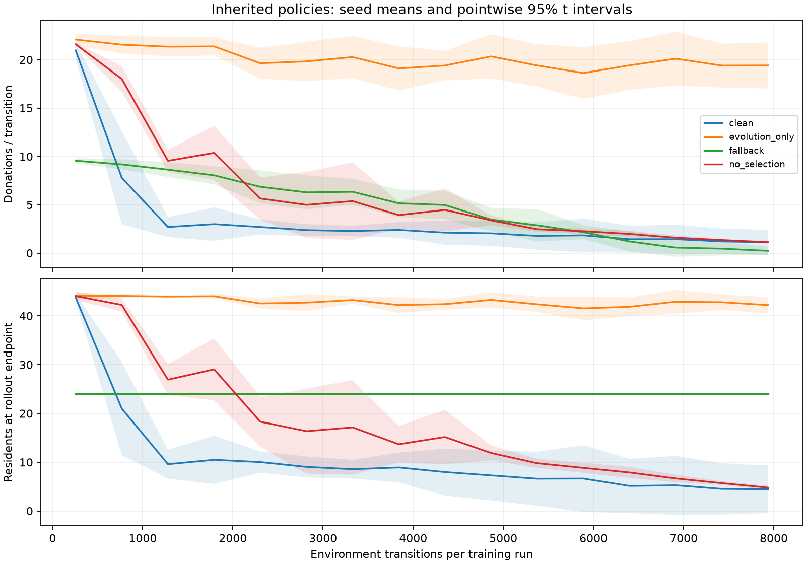
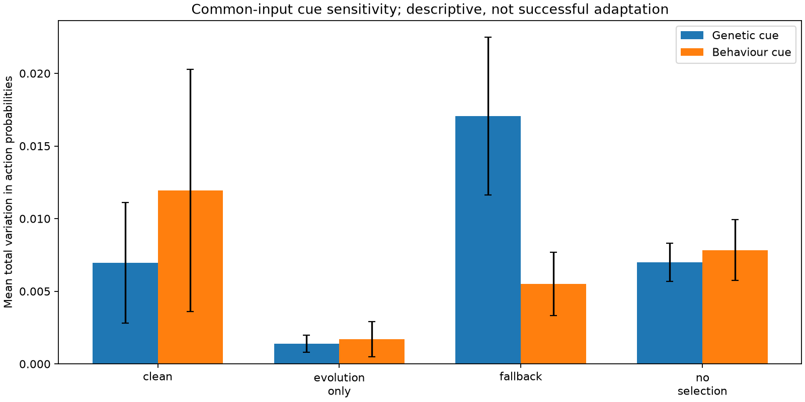

# Inherited policy diagnostics

Full-policy cue permutation is an exploratory off-manifold diagnostic, not causal reliability. Networks within a run are not independent replicates.

| Condition | Genetic cue sensitivity | Behaviour cue sensitivity | Genetic gate weight |
| --- | --- | --- | --- |
| clean | 0.00696; n=5; CI=[0.0028112530822401224, 0.011103113442115986] | 0.01194; n=5; CI=[0.00359545876380433, 0.02028445585832865] | 0.51252; n=5; CI=[0.2788215786429, 0.7462147687661893] |
| evolution_only | 0.00138; n=5; CI=[0.0007929931488646061, 0.001971686629813116] | 0.00170; n=5; CI=[0.0004912624243445316, 0.002908589144630023] | 0.50792; n=5; CI=[0.4552779334790598, 0.5605716314904798] |
| fallback | 0.01707; n=5; CI=[0.01163278344700877, 0.022506313611981577] | 0.00550; n=5; CI=[0.0033185632934648454, 0.007672828335360571] | 0.72377; n=5; CI=[0.6438355352260854, 0.8037061253410394] |
| no_selection | 0.00700; n=5; CI=[0.005685761802695411, 0.008311342047428992] | 0.00784; n=5; CI=[0.005747777686856545, 0.009933001545592976] | 0.45016; n=5; CI=[0.4193937006666299, 0.48091826240727936] |

No genetic-to-behavioural adaptation claim is supported unless clean cooperation and the independently trained cue comparisons succeed.

Paired seed-level contrasts and the explicit regression status: [diagnostics.json](diagnostics.json).

