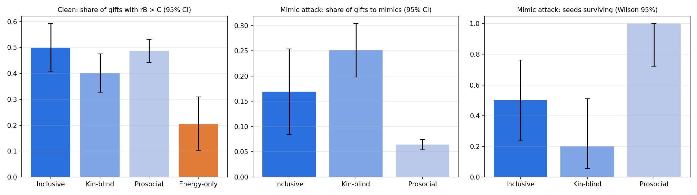
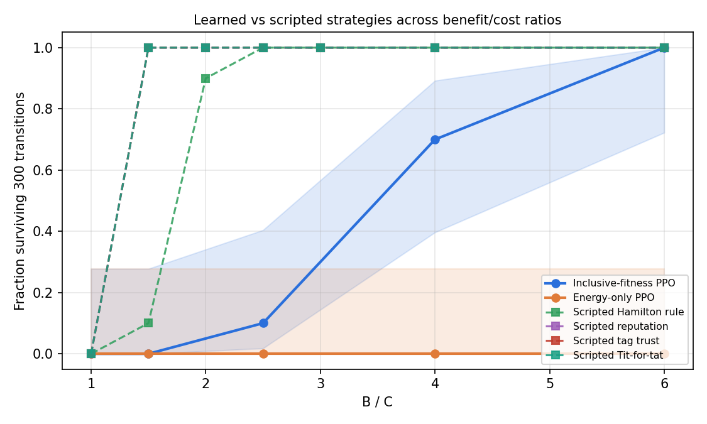

# Robustness and reward-control study (B/C = 4): results

Generated by `evaluation/robustness_report.py`. 10 training seeds per condition, 3 evaluation worlds per seed (averaged within seed), 8,192 transitions per run (4x for the long-training condition). Baselines `inclusive_bc400` and `energy_bc400` come from the main study (same code, seeds and worlds). Brackets: 95% Student-t interval over seeds; survival: Wilson interval.

**Mimic slots.** Mimics can only take free slots, so a population already at its cap of 45 would receive no attack. Every attacked ecology here therefore reserves 6 slots that only mimics can use (capacity 51, births still stop at 45 residents), and every attack delivers its 6 mimics; the `mimics_injected` column of `evaluation_runs.csv` records this for each episode. The five mimic conditions were trained and evaluated with this reserve (source archived in `source/`). The other conditions have no mimics, so the reserve never applies to them; they were trained with the previous version of the Study C training script (archived in `source_v1/`, identical apart from the reserve), and `evaluation/verify_hamilton.py --study robustness` re-simulates them exactly with the current code.

## 1. All conditions (trained policies)

| Condition | Evaluation | Seeds surviving | Donations / step | Lifetime | Share of gifts with rB > C | Kin preference | Mimic share | Gate w^g |
| --- | --- | --- | --- | --- | --- | --- | --- | --- |
| Inclusive (kin-weighted) reward | clean | 7/10 | 0.405 [0.180, 0.629] | 285.3 [267.0, 303.6] | 0.499 [0.406, 0.592] | 0.039 [0.001, 0.078] | undefined | 0.558 [0.341, 0.775] |
| Energy-only reward | clean | 0/10 | 0.016 [0.007, 0.026] | 72.7 [57.5, 87.9] | 0.205 [0.101, 0.309] | -0.042 [-0.081, -0.003] | undefined | 0.386 [0.316, 0.455] |
| Prosocial reward (+B for any gift) | clean | 10/10 | 0.994 [0.988, 1.001] | 300.0 [300.0, 300.0] | 0.487 [0.442, 0.532] | 0.009 [0.002, 0.015] | undefined | 0.083 [-0.083, 0.248] |
| Kin-blind reward (mean neighbour r) | clean | 6/10 | 0.307 [0.085, 0.529] | 282.4 [259.9, 305.0] | 0.401 [0.327, 0.475] | 0.001 [-0.007, 0.010] | undefined | 0.417 [0.249, 0.585] |
| Inclusive, trained with mimics | clean | 9/10 | 0.508 [0.279, 0.736] | 293.8 [279.9, 307.8] | 0.589 [0.449, 0.728] | 0.045 [0.008, 0.082] | undefined | 0.537 [0.271, 0.803] |
| Inclusive, trained with mimics | attack | 5/10 | 0.500 [0.268, 0.732] | 262.7 [230.2, 295.1] | 0.471 [0.346, 0.596] | 0.043 [0.006, 0.079] | 0.169 [0.084, 0.254] | 0.557 [0.301, 0.812] |
| Prosocial, trained with mimics | clean | 10/10 | 0.999 [0.997, 1.000] | 300.0 [300.0, 300.0] | 0.478 [0.428, 0.529] | 0.005 [-0.002, 0.013] | undefined | 0.038 [-0.034, 0.111] |
| Prosocial, trained with mimics | attack | 10/10 | 0.998 [0.997, 1.000] | 300.0 [300.0, 300.0] | 0.458 [0.411, 0.504] | 0.008 [-0.002, 0.018] | 0.064 [0.054, 0.074] | 0.040 [-0.035, 0.115] |
| Kin-blind, trained with mimics | clean | 9/10 | 0.275 [0.151, 0.398] | 298.6 [295.5, 301.7] | 0.436 [0.384, 0.488] | 0.004 [-0.011, 0.018] | undefined | 0.357 [0.162, 0.552] |
| Kin-blind, trained with mimics | attack | 2/10 | 0.271 [0.143, 0.398] | 252.9 [228.3, 277.4] | 0.324 [0.263, 0.384] | 0.001 [-0.012, 0.015] | 0.251 [0.198, 0.304] | 0.398 [0.228, 0.568] |
| Inclusive, cue noise 0.25 | clean | 4/10 | 0.139 [0.113, 0.165] | 281.2 [258.9, 303.5] | 0.420 [0.350, 0.490] | -0.002 [-0.005, 0.001] | undefined | 0.241 [0.073, 0.410] |
| Inclusive, cue noise 0.50 | clean | 2/10 | 0.121 [0.092, 0.150] | 262.2 [235.7, 288.7] | 0.429 [0.388, 0.471] | -0.000 [-0.004, 0.003] | undefined | 0.273 [0.105, 0.441] |
| Inclusive, noise 0.50 + mimics (learned gate) | clean | 10/10 | 0.266 [0.173, 0.359] | 300.0 [300.0, 300.0] | 0.507 [0.432, 0.582] | 0.001 [-0.002, 0.004] | undefined | 0.114 [-0.036, 0.263] |
| Inclusive, noise 0.50 + mimics (learned gate) | attack | 1/10 | 0.265 [0.167, 0.364] | 247.8 [215.7, 279.9] | 0.332 [0.261, 0.403] | -0.002 [-0.009, 0.005] | 0.260 [0.207, 0.313] | 0.131 [-0.002, 0.264] |
| Inclusive, noise 0.50 + mimics (fixed gate) | clean | 10/10 | 0.262 [0.219, 0.305] | 300.0 [300.0, 300.0] | 0.424 [0.368, 0.481] | 0.001 [-0.004, 0.005] | undefined | 0.500 [0.500, 0.500] |
| Inclusive, noise 0.50 + mimics (fixed gate) | attack | 2/10 | 0.277 [0.201, 0.353] | 250.1 [221.1, 279.1] | 0.326 [0.244, 0.409] | -0.003 [-0.011, 0.004] | 0.240 [0.171, 0.310] | 0.500 [0.500, 0.500] |
| Inclusive, fixed gate | clean | 8/10 | 0.621 [0.357, 0.885] | 285.0 [254.2, 315.9] | 0.515 [0.421, 0.610] | 0.045 [0.013, 0.077] | undefined | 0.500 [0.500, 0.500] |
| Inclusive, MLP (no attention) | clean | 8/10 | 0.406 [0.228, 0.585] | 296.7 [289.4, 304.0] | 0.370 [0.332, 0.408] | -0.003 [-0.013, 0.007] | undefined | undefined |
| Inclusive, random offspring placement | clean | 3/10 | 0.120 [0.070, 0.171] | 241.8 [186.0, 297.7] | 0.300 [0.194, 0.406] | 0.005 [-0.004, 0.015] | undefined | 0.371 [0.231, 0.511] |
| Inclusive, mutation 0 | clean | 7/10 | 0.574 [0.294, 0.854] | 254.0 [199.2, 308.8] | 0.357 [0.024, 0.689] | 0.006 [-0.001, 0.014] | undefined | 0.616 [0.422, 0.810] |
| Inclusive, mutation 0.20 | clean | 4/10 | 0.161 [0.051, 0.271] | 243.9 [200.8, 287.0] | 0.317 [0.251, 0.382] | 0.003 [-0.006, 0.012] | undefined | 0.316 [0.192, 0.440] |
| Inclusive, gamma 0.99 | clean | 2/10 | 0.188 [0.033, 0.342] | 240.3 [205.7, 274.8] | 0.358 [0.230, 0.485] | 0.002 [-0.010, 0.014] | undefined | 0.438 [0.276, 0.601] |
| Energy-only, gamma 0.99 | clean | 2/10 | 0.101 [0.083, 0.118] | 237.5 [195.3, 279.8] | 0.309 [0.193, 0.425] | -0.014 [-0.025, -0.003] | undefined | 0.330 [0.187, 0.472] |
| Evolution only (no learning) | clean | 10/10 | 0.553 [0.535, 0.572] | 300.0 [300.0, 300.0] | 0.352 [0.307, 0.397] | 0.001 [-0.001, 0.003] | undefined | 0.500 [0.409, 0.591] |
| Inclusive, B/C 2.5, 4x training | clean | 2/10 | 0.182 [-0.026, 0.389] | 118.0 [34.5, 201.6] | 0.248 [-0.045, 0.541] | 0.017 [-0.004, 0.038] | undefined | 0.567 [0.391, 0.742] |
| Inclusive, B/C 2.5, 1x training | clean | 1/10 | 0.242 [0.078, 0.406] | 215.5 [160.2, 270.8] | 0.316 [0.136, 0.495] | 0.007 [-0.004, 0.018] | undefined | 0.517 [0.363, 0.671] |

## 2. Untrained-network and scripted controls

| Condition | Actor | Evaluation | Seeds surviving | Donations / step | Lifetime | Mimic share |
| --- | --- | --- | --- | --- | --- | --- |
| Inclusive (kin-weighted) reward | untrained_ancestors | clean | 10/10 | 0.568 [0.532, 0.603] | 300.0 [300.0, 300.0] | undefined |
| Energy-only reward | untrained_ancestors | clean | 10/10 | 0.526 [0.501, 0.550] | 300.0 [300.0, 300.0] | undefined |
| Prosocial reward (+B for any gift) | untrained_ancestors | clean | 10/10 | 0.530 [0.510, 0.550] | 300.0 [300.0, 300.0] | undefined |
| Kin-blind reward (mean neighbour r) | untrained_ancestors | clean | 10/10 | 0.538 [0.520, 0.555] | 300.0 [300.0, 300.0] | undefined |
| Inclusive, trained with mimics | untrained_ancestors | clean | 10/10 | 0.534 [0.501, 0.567] | 300.0 [300.0, 300.0] | undefined |
| Inclusive, trained with mimics | untrained_ancestors | attack | 10/10 | 0.553 [0.522, 0.585] | 300.0 [300.0, 300.0] | 0.134 [0.125, 0.143] |
| Inclusive, trained with mimics | rule_dyadic_tit_for_tat | attack | 0/10 | 0.105 [0.029, 0.180] | 72.6 [44.4, 100.8] | 0.900 [0.785, 1.015] |
| Inclusive, trained with mimics | rule_hamilton_rule | attack | 7/10 | 0.615 [0.309, 0.921] | 223.8 [136.0, 311.6] | 0.001 [0.001, 0.001] |
| Inclusive, trained with mimics | rule_reputation | attack | 10/10 | 0.992 [0.992, 0.993] | 300.0 [300.0, 300.0] | 0.000 [0.000, 0.000] |
| Inclusive, trained with mimics | rule_selfish | attack | 0/10 | 0.000 [0.000, 0.000] | 40.8 [40.0, 41.6] | undefined |
| Inclusive, trained with mimics | rule_tag_trust | attack | 7/10 | 0.611 [0.307, 0.915] | 223.8 [136.0, 311.6] | 0.001 [0.001, 0.001] |
| Prosocial, trained with mimics | untrained_ancestors | clean | 10/10 | 0.552 [0.518, 0.586] | 300.0 [300.0, 300.0] | undefined |
| Prosocial, trained with mimics | untrained_ancestors | attack | 10/10 | 0.573 [0.539, 0.607] | 300.0 [300.0, 300.0] | 0.138 [0.119, 0.157] |
| Kin-blind, trained with mimics | untrained_ancestors | clean | 10/10 | 0.546 [0.520, 0.572] | 300.0 [300.0, 300.0] | undefined |
| Kin-blind, trained with mimics | untrained_ancestors | attack | 10/10 | 0.565 [0.541, 0.589] | 300.0 [300.0, 300.0] | 0.134 [0.124, 0.144] |
| Inclusive, cue noise 0.25 | untrained_ancestors | clean | 10/10 | 0.537 [0.506, 0.569] | 300.0 [300.0, 300.0] | undefined |
| Inclusive, cue noise 0.50 | untrained_ancestors | clean | 10/10 | 0.522 [0.506, 0.539] | 300.0 [300.0, 300.0] | undefined |
| Inclusive, noise 0.50 + mimics (learned gate) | untrained_ancestors | clean | 10/10 | 0.544 [0.512, 0.577] | 300.0 [300.0, 300.0] | undefined |
| Inclusive, noise 0.50 + mimics (learned gate) | untrained_ancestors | attack | 10/10 | 0.565 [0.533, 0.597] | 300.0 [300.0, 300.0] | 0.142 [0.126, 0.159] |
| Inclusive, noise 0.50 + mimics (learned gate) | rule_dyadic_tit_for_tat | attack | 0/10 | 0.175 [0.070, 0.280] | 99.7 [58.3, 141.1] | 0.801 [0.635, 0.967] |
| Inclusive, noise 0.50 + mimics (learned gate) | rule_hamilton_rule | attack | 10/10 | 0.824 [0.819, 0.830] | 300.0 [300.0, 300.0] | 0.058 [0.048, 0.068] |
| Inclusive, noise 0.50 + mimics (learned gate) | rule_reputation | attack | 10/10 | 0.992 [0.992, 0.993] | 300.0 [300.0, 300.0] | 0.000 [0.000, 0.000] |
| Inclusive, noise 0.50 + mimics (learned gate) | rule_selfish | attack | 0/10 | 0.000 [0.000, 0.000] | 40.4 [39.6, 41.2] | undefined |
| Inclusive, noise 0.50 + mimics (learned gate) | rule_tag_trust | attack | 10/10 | 0.673 [0.664, 0.682] | 300.0 [300.0, 300.0] | 0.061 [0.051, 0.072] |
| Inclusive, noise 0.50 + mimics (fixed gate) | untrained_ancestors | clean | 10/10 | 0.517 [0.495, 0.539] | 300.0 [300.0, 300.0] | undefined |
| Inclusive, noise 0.50 + mimics (fixed gate) | untrained_ancestors | attack | 10/10 | 0.537 [0.515, 0.558] | 300.0 [300.0, 300.0] | 0.143 [0.122, 0.164] |
| Inclusive, fixed gate | untrained_ancestors | clean | 10/10 | 0.538 [0.509, 0.567] | 300.0 [300.0, 300.0] | undefined |
| Inclusive, MLP (no attention) | untrained_ancestors | clean | 10/10 | 0.552 [0.523, 0.581] | 300.0 [300.0, 300.0] | undefined |
| Inclusive, random offspring placement | untrained_ancestors | clean | 10/10 | 0.551 [0.523, 0.579] | 300.0 [300.0, 300.0] | undefined |
| Inclusive, mutation 0 | untrained_ancestors | clean | 10/10 | 0.546 [0.519, 0.572] | 300.0 [300.0, 300.0] | undefined |
| Inclusive, mutation 0.20 | untrained_ancestors | clean | 10/10 | 0.528 [0.502, 0.553] | 300.0 [300.0, 300.0] | undefined |
| Inclusive, gamma 0.99 | untrained_ancestors | clean | 10/10 | 0.521 [0.492, 0.550] | 300.0 [300.0, 300.0] | undefined |
| Energy-only, gamma 0.99 | untrained_ancestors | clean | 10/10 | 0.548 [0.515, 0.581] | 300.0 [300.0, 300.0] | undefined |
| Evolution only (no learning) | untrained_ancestors | clean | 10/10 | 0.553 [0.535, 0.572] | 300.0 [300.0, 300.0] | undefined |
| Inclusive, B/C 2.5, 4x training | untrained_ancestors | clean | 10/10 | 0.497 [0.473, 0.522] | 300.0 [300.0, 300.0] | undefined |
| Inclusive, B/C 2.5, 1x training | untrained_ancestors | clean | 10/10 | 0.498 [0.473, 0.522] | 300.0 [300.0, 300.0] | undefined |

## 3. Survival comparisons (Fisher exact test)

| Comparison | First | Second | p |
| --- | --- | --- | --- |
| inclusive vs energy-only (gamma 0.9) | 7/10 | 0/10 | 3.10e-03 |
| inclusive vs energy-only (gamma 0.99) | 2/10 | 2/10 | 1.00e+00 |
| inclusive vs prosocial | 7/10 | 10/10 | 2.11e-01 |
| inclusive vs kin-blind | 7/10 | 6/10 | 1.00e+00 |
| inclusive vs prosocial (mimics) | 5/10 | 10/10 | 3.25e-02 |
| inclusive vs kin-blind (mimics) | 5/10 | 2/10 | 3.50e-01 |
| 4x vs 1x training (B/C 2.5) | 2/10 | 1/10 | 1.00e+00 |

## 4. Paired contrasts by seed (exact sign-flip; minimum attainable p with 10 pairs = 0.0020)

| Contrast | Metric | Difference | Seeds positive | p |
| --- | --- | --- | --- | --- |
| inclusive - prosocial | hamilton_consistent_fraction | 0.012 [-0.088, 0.112] | 5/10 | 0.8008 |
| inclusive - kin-blind | hamilton_consistent_fraction | 0.098 [0.026, 0.170] | 8/10 | 0.0098 |
| inclusive - untrained | hamilton_consistent_fraction | 0.076 [-0.036, 0.189] | 7/10 | 0.2070 |
| prosocial - untrained | hamilton_consistent_fraction | 0.100 [0.060, 0.140] | 10/10 | 0.0020 |
| kin-blind - untrained | hamilton_consistent_fraction | -0.002 [-0.036, 0.032] | 4/10 | 0.8926 |
| inclusive - prosocial | kin_preference | 0.031 [-0.007, 0.069] | 7/10 | 0.1035 |
| inclusive - kin-blind | kin_preference | 0.038 [0.006, 0.070] | 8/10 | 0.0254 |
| inclusive - untrained | kin_preference | 0.039 [0.000, 0.077] | 7/10 | 0.0430 |
| prosocial - untrained | kin_preference | 0.008 [0.002, 0.014] | 8/10 | 0.0117 |
| kin-blind - untrained | kin_preference | 0.002 [-0.007, 0.011] | 5/10 | 0.6211 |
| inclusive - prosocial | donations_per_resident_step | -0.589 [-0.811, -0.368] | 0/10 | 0.0020 |
| inclusive - kin-blind | donations_per_resident_step | 0.098 [-0.137, 0.332] | 6/10 | 0.3691 |
| inclusive - untrained | donations_per_resident_step | -0.163 [-0.387, 0.061] | 3/10 | 0.1465 |
| prosocial - untrained | donations_per_resident_step | 0.464 [0.445, 0.483] | 10/10 | 0.0020 |
| kin-blind - untrained | donations_per_resident_step | -0.231 [-0.442, -0.019] | 2/10 | 0.0410 |
| inclusive - prosocial | duration | -14.700 [-33.002, 3.602] | 0/10 | 0.2500 |
| inclusive - kin-blind | duration | 2.867 [-29.207, 34.941] | 3/10 | 0.8438 |
| inclusive - untrained | duration | -14.700 [-33.002, 3.602] | 0/10 | 0.2500 |
| prosocial - untrained | duration | 0.000 [0.000, 0.000] | 0/10 | 1.0000 |
| kin-blind - untrained | duration | -17.567 [-40.146, 5.012] | 0/10 | 0.1250 |
| inclusive - prosocial (mimics) | mimic_donation_share | 0.105 [0.022, 0.188] | 8/10 | 0.0352 |
| inclusive - kin-blind (mimics) | mimic_donation_share | -0.082 [-0.180, 0.016] | 3/10 | 0.0918 |
| learned - fixed gate (noise 0.5, mimics) | mimic_donation_share | 0.019 [-0.037, 0.076] | 7/10 | 0.4375 |
| inclusive - prosocial (mimics) | duration | -37.333 [-69.764, -4.903] | 0/10 | 0.0625 |
| inclusive - kin-blind (mimics) | duration | 9.800 [-27.532, 47.132] | 4/10 | 0.5781 |
| learned - fixed gate (noise 0.5, mimics) | duration | -2.300 [-36.609, 32.009] | 4/10 | 0.8867 |
| inclusive - prosocial (mimics) | final_residents | -21.900 [-38.432, -5.368] | 0/10 | 0.0625 |
| inclusive - kin-blind (mimics) | final_residents | 14.233 [-1.748, 30.215] | 4/10 | 0.1250 |
| learned - fixed gate (noise 0.5, mimics) | final_residents | -5.500 [-14.849, 3.849] | 2/10 | 0.2188 |
| learned - fixed gate | donations_per_resident_step | -0.216 [-0.467, 0.034] | 4/10 | 0.1074 |
| attention - MLP | donations_per_resident_step | -0.001 [-0.229, 0.226] | 6/10 | 0.9844 |
| mutation 0.05 - 0 | donations_per_resident_step | -0.169 [-0.575, 0.237] | 5/10 | 0.3750 |
| mutation 0.05 - 0.20 | donations_per_resident_step | 0.244 [0.018, 0.470] | 9/10 | 0.0137 |
| noise 0 - 0.50 | donations_per_resident_step | 0.284 [0.067, 0.501] | 8/10 | 0.0137 |
| gamma 0.9 - 0.99 (inclusive) | donations_per_resident_step | 0.217 [-0.071, 0.506] | 8/10 | 0.1309 |
| inclusive PPO - evolution only | donations_per_resident_step | -0.149 [-0.375, 0.078] | 3/10 | 0.1641 |
| 4x - 1x training (B/C 2.5) | donations_per_resident_step | -0.060 [-0.255, 0.135] | 2/10 | 0.4980 |
| 4x training - untrained (B/C 2.5) | donations_per_resident_step | -0.316 [-0.527, -0.104] | 2/10 | 0.0137 |
| learned - fixed gate | duration | 0.267 [-19.961, 20.494] | 2/10 | 1.0000 |
| attention - MLP | duration | -11.400 [-29.224, 6.424] | 0/10 | 0.2500 |
| mutation 0.05 - 0 | duration | 31.267 [-18.249, 80.782] | 3/10 | 0.2500 |
| mutation 0.05 - 0.20 | duration | 41.433 [-8.051, 90.917] | 6/10 | 0.0781 |
| noise 0 - 0.50 | duration | 23.100 [-8.851, 55.051] | 5/10 | 0.1406 |
| gamma 0.9 - 0.99 (inclusive) | duration | 45.033 [14.880, 75.187] | 8/10 | 0.0078 |
| inclusive PPO - evolution only | duration | -14.700 [-33.002, 3.602] | 0/10 | 0.2500 |
| 4x - 1x training (B/C 2.5) | duration | -97.500 [-173.738, -21.262] | 1/10 | 0.0234 |
| 4x training - untrained (B/C 2.5) | duration | -181.967 [-265.539, -98.394] | 0/10 | 0.0078 |
| learned - fixed gate | hamilton_consistent_fraction | -0.016 [-0.148, 0.115] | 5/10 | 0.7715 |
| attention - MLP | hamilton_consistent_fraction | 0.129 [0.041, 0.218] | 7/10 | 0.0156 |
| mutation 0.05 - 0 | hamilton_consistent_fraction | 0.142 [-0.255, 0.539] | 6/10 | 0.4160 |
| mutation 0.05 - 0.20 | hamilton_consistent_fraction | 0.182 [0.065, 0.300] | 9/10 | 0.0059 |
| noise 0 - 0.50 | hamilton_consistent_fraction | 0.070 [-0.049, 0.188] | 6/10 | 0.2168 |
| gamma 0.9 - 0.99 (inclusive) | hamilton_consistent_fraction | 0.141 [0.032, 0.250] | 8/10 | 0.0234 |
| inclusive PPO - evolution only | hamilton_consistent_fraction | 0.147 [0.063, 0.231] | 9/10 | 0.0059 |
| 4x - 1x training (B/C 2.5) | hamilton_consistent_fraction | -0.068 [-0.284, 0.148] | 3/10 | 0.4453 |
| 4x training - untrained (B/C 2.5) | hamilton_consistent_fraction | -0.299 [-0.606, 0.009] | 3/10 | 0.0566 |
| local - random placement | adjacent_similarity | -0.015 [-0.128, 0.099] | 6/10 | 0.7812 |
| local - random placement (untrained) | adjacent_similarity | -0.037 [-0.135, 0.061] | 4/10 | 0.4102 |
| inclusive_bc400 - b4_noise050 | choice_genetic | 0.217 [0.045, 0.388] | 8/10 | 0.0137 |
| inclusive_bc400 - b4_noise050 | choice_genetic_share | 0.222 [-0.021, 0.465] | 8/10 | 0.0723 |
| inclusive_bc400 - b4_noise025 | choice_genetic | 0.207 [0.009, 0.406] | 7/10 | 0.0410 |
| inclusive_bc400 - b4_noise025 | choice_genetic_share | 0.510 [0.390, 0.629] | 10/10 | 0.0020 |
| inclusive_bc400 - b4_prosocial | choice_genetic | 0.170 [-0.025, 0.366] | 6/10 | 0.0918 |
| inclusive_bc400 - b4_prosocial | choice_genetic_share | 0.418 [0.185, 0.650] | 9/10 | 0.0039 |
| inclusive_bc400 - b4_kinblind | choice_genetic | 0.195 [0.016, 0.373] | 7/10 | 0.0332 |
| inclusive_bc400 - b4_kinblind | choice_genetic_share | 0.337 [0.139, 0.535] | 7/10 | 0.0156 |

## 5. Recipient-choice reliance (per-seed standardised conditional logit)

| Condition | Genetic cue | Behavioural cue | Genetic share | Seeds with >= 20 gifts |
| --- | --- | --- | --- | --- |
| Inclusive (kin-weighted) reward | 0.199 [0.004, 0.394] | 0.009 [-0.026, 0.043] | 0.780 [0.657, 0.904] | 10 |
| Inclusive, cue noise 0.25 | -0.009 [-0.020, 0.003] | -0.043 [-0.114, 0.028] | 0.271 [0.103, 0.438] | 10 |
| Inclusive, cue noise 0.50 | -0.018 [-0.070, 0.035] | -0.004 [-0.063, 0.055] | 0.558 [0.366, 0.751] | 10 |
| Prosocial reward (+B for any gift) | 0.028 [0.006, 0.051] | -0.028 [-0.104, 0.047] | 0.363 [0.166, 0.560] | 10 |
| Kin-blind reward (mean neighbour r) | 0.004 [-0.032, 0.040] | -0.039 [-0.071, -0.006] | 0.444 [0.284, 0.604] | 10 |

## 6. Scripted strategies in every ecology (10 fresh worlds each, random founders)

| Ecology | B/C | Strategy | Worlds surviving | Donations / step | Lifetime | Share of gifts with rB > C | Mimic share |
| --- | --- | --- | --- | --- | --- | --- | --- |
| bc100 | 1.0 | dyadic_tit_for_tat | 0/10 | 0.632 [0.582, 0.682] | 46.7 [45.0, 48.4] | 0.000 [0.000, 0.000] | undefined |
| bc100 | 1.0 | hamilton_rule | 0/10 | 0.000 [0.000, 0.000] | 47.0 [45.5, 48.5] | undefined | undefined |
| bc100 | 1.0 | reputation | 0/10 | 0.901 [0.880, 0.923] | 81.5 [76.6, 86.4] | 0.000 [0.000, 0.000] | undefined |
| bc100 | 1.0 | selfish | 0/10 | 0.000 [0.000, 0.000] | 42.9 [41.3, 44.5] | undefined | undefined |
| bc100 | 1.0 | tag_trust | 0/10 | 0.364 [0.295, 0.432] | 56.1 [51.5, 60.7] | 0.000 [0.000, 0.000] | undefined |
| bc150 | 1.5 | dyadic_tit_for_tat | 10/10 | 0.715 [0.689, 0.741] | 300.0 [300.0, 300.0] | 0.137 [0.069, 0.204] | undefined |
| bc150 | 1.5 | hamilton_rule | 1/10 | 0.168 [0.039, 0.297] | 125.2 [77.2, 173.2] | 1.000 [1.000, 1.000] | undefined |
| bc150 | 1.5 | reputation | 10/10 | 0.959 [0.956, 0.963] | 300.0 [300.0, 300.0] | 0.754 [0.693, 0.815] | undefined |
| bc150 | 1.5 | selfish | 0/10 | 0.000 [0.000, 0.000] | 42.9 [41.3, 44.5] | undefined | undefined |
| bc150 | 1.5 | tag_trust | 10/10 | 0.823 [0.761, 0.886] | 300.0 [300.0, 300.0] | 0.842 [0.809, 0.875] | undefined |
| bc200 | 2.0 | dyadic_tit_for_tat | 10/10 | 0.558 [0.545, 0.571] | 300.0 [300.0, 300.0] | 0.403 [0.349, 0.457] | undefined |
| bc200 | 2.0 | hamilton_rule | 9/10 | 0.813 [0.635, 0.992] | 280.8 [237.4, 324.2] | 1.000 [1.000, 1.000] | undefined |
| bc200 | 2.0 | reputation | 10/10 | 0.981 [0.978, 0.983] | 300.0 [300.0, 300.0] | 0.758 [0.700, 0.816] | undefined |
| bc200 | 2.0 | selfish | 0/10 | 0.000 [0.000, 0.000] | 42.9 [41.3, 44.5] | undefined | undefined |
| bc200 | 2.0 | tag_trust | 10/10 | 0.939 [0.930, 0.948] | 300.0 [300.0, 300.0] | 0.978 [0.972, 0.984] | undefined |
| bc250 | 2.5 | dyadic_tit_for_tat | 10/10 | 0.657 [0.630, 0.684] | 300.0 [300.0, 300.0] | 0.568 [0.492, 0.644] | undefined |
| bc250 | 2.5 | hamilton_rule | 10/10 | 0.945 [0.935, 0.954] | 300.0 [300.0, 300.0] | 1.000 [1.000, 1.000] | undefined |
| bc250 | 2.5 | reputation | 10/10 | 0.987 [0.986, 0.989] | 300.0 [300.0, 300.0] | 0.841 [0.778, 0.904] | undefined |
| bc250 | 2.5 | selfish | 0/10 | 0.000 [0.000, 0.000] | 42.9 [41.3, 44.5] | undefined | undefined |
| bc250 | 2.5 | tag_trust | 10/10 | 0.950 [0.945, 0.955] | 300.0 [300.0, 300.0] | 0.995 [0.989, 1.000] | undefined |
| bc300 | 3.0 | dyadic_tit_for_tat | 10/10 | 0.616 [0.583, 0.649] | 300.0 [300.0, 300.0] | 0.628 [0.566, 0.690] | undefined |
| bc300 | 3.0 | hamilton_rule | 10/10 | 0.955 [0.948, 0.962] | 300.0 [300.0, 300.0] | 1.000 [1.000, 1.000] | undefined |
| bc300 | 3.0 | reputation | 10/10 | 0.990 [0.988, 0.991] | 300.0 [300.0, 300.0] | 0.819 [0.769, 0.869] | undefined |
| bc300 | 3.0 | selfish | 0/10 | 0.000 [0.000, 0.000] | 42.9 [41.3, 44.5] | undefined | undefined |
| bc300 | 3.0 | tag_trust | 10/10 | 0.955 [0.949, 0.961] | 300.0 [300.0, 300.0] | 1.000 [0.999, 1.000] | undefined |
| bc400 | 4.0 | dyadic_tit_for_tat | 10/10 | 0.612 [0.570, 0.654] | 300.0 [300.0, 300.0] | 0.562 [0.482, 0.642] | undefined |
| bc400 | 4.0 | hamilton_rule | 10/10 | 0.962 [0.952, 0.972] | 300.0 [300.0, 300.0] | 1.000 [1.000, 1.000] | undefined |
| bc400 | 4.0 | reputation | 10/10 | 0.994 [0.993, 0.995] | 300.0 [300.0, 300.0] | 0.815 [0.750, 0.879] | undefined |
| bc400 | 4.0 | selfish | 0/10 | 0.000 [0.000, 0.000] | 42.9 [41.3, 44.5] | undefined | undefined |
| bc400 | 4.0 | tag_trust | 10/10 | 0.958 [0.951, 0.965] | 300.0 [300.0, 300.0] | 1.000 [1.000, 1.000] | undefined |
| bc400_mimics | 4.0 | dyadic_tit_for_tat | 10/10 | 0.619 [0.573, 0.664] | 300.0 [300.0, 300.0] | 0.548 [0.490, 0.606] | 0.004 [0.001, 0.006] |
| bc400_mimics | 4.0 | hamilton_rule | 10/10 | 0.965 [0.956, 0.973] | 300.0 [300.0, 300.0] | 0.999 [0.999, 1.000] | 0.001 [0.000, 0.001] |
| bc400_mimics | 4.0 | reputation | 10/10 | 0.993 [0.992, 0.994] | 300.0 [300.0, 300.0] | 0.804 [0.732, 0.875] | 0.000 [0.000, 0.000] |
| bc400_mimics | 4.0 | selfish | 0/10 | 0.000 [0.000, 0.000] | 40.6 [39.5, 41.7] | undefined | undefined |
| bc400_mimics | 4.0 | tag_trust | 10/10 | 0.963 [0.958, 0.968] | 300.0 [300.0, 300.0] | 0.999 [0.999, 1.000] | 0.001 [0.000, 0.001] |
| bc400_noise050 | 4.0 | dyadic_tit_for_tat | 10/10 | 0.589 [0.551, 0.626] | 300.0 [300.0, 300.0] | 0.554 [0.475, 0.632] | undefined |
| bc400_noise050 | 4.0 | hamilton_rule | 10/10 | 0.800 [0.788, 0.812] | 300.0 [300.0, 300.0] | 0.378 [0.338, 0.418] | undefined |
| bc400_noise050 | 4.0 | reputation | 10/10 | 0.993 [0.992, 0.994] | 300.0 [300.0, 300.0] | 0.839 [0.780, 0.898] | undefined |
| bc400_noise050 | 4.0 | selfish | 0/10 | 0.000 [0.000, 0.000] | 43.2 [41.5, 44.9] | undefined | undefined |
| bc400_noise050 | 4.0 | tag_trust | 10/10 | 0.638 [0.623, 0.653] | 300.0 [300.0, 300.0] | 0.395 [0.355, 0.436] | undefined |
| bc400_noise050_mimics | 4.0 | dyadic_tit_for_tat | 10/10 | 0.619 [0.595, 0.643] | 300.0 [300.0, 300.0] | 0.572 [0.497, 0.647] | 0.004 [0.002, 0.005] |
| bc400_noise050_mimics | 4.0 | hamilton_rule | 10/10 | 0.821 [0.804, 0.839] | 300.0 [300.0, 300.0] | 0.389 [0.367, 0.412] | 0.066 [0.052, 0.079] |
| bc400_noise050_mimics | 4.0 | reputation | 10/10 | 0.993 [0.992, 0.994] | 300.0 [300.0, 300.0] | 0.820 [0.750, 0.890] | 0.000 [-0.000, 0.000] |
| bc400_noise050_mimics | 4.0 | selfish | 0/10 | 0.000 [0.000, 0.000] | 40.8 [39.9, 41.7] | undefined | undefined |
| bc400_noise050_mimics | 4.0 | tag_trust | 10/10 | 0.669 [0.658, 0.680] | 300.0 [300.0, 300.0] | 0.387 [0.336, 0.438] | 0.067 [0.035, 0.099] |
| bc600 | 6.0 | dyadic_tit_for_tat | 10/10 | 0.579 [0.541, 0.616] | 300.0 [300.0, 300.0] | 0.547 [0.468, 0.626] | undefined |
| bc600 | 6.0 | hamilton_rule | 10/10 | 0.980 [0.976, 0.985] | 300.0 [300.0, 300.0] | 1.000 [1.000, 1.000] | undefined |
| bc600 | 6.0 | reputation | 10/10 | 0.995 [0.994, 0.996] | 300.0 [300.0, 300.0] | 0.837 [0.784, 0.890] | undefined |
| bc600 | 6.0 | selfish | 0/10 | 0.000 [0.000, 0.000] | 42.9 [41.3, 44.5] | undefined | undefined |
| bc600 | 6.0 | tag_trust | 10/10 | 0.961 [0.950, 0.971] | 300.0 [300.0, 300.0] | 1.000 [1.000, 1.000] | undefined |

## Spreadsheets

[seed_summary.csv](seed_summary.csv), [evaluation_runs.csv](evaluation_runs.csv), [strategy_sweep.csv](strategy_sweep.csv).

## Figures

