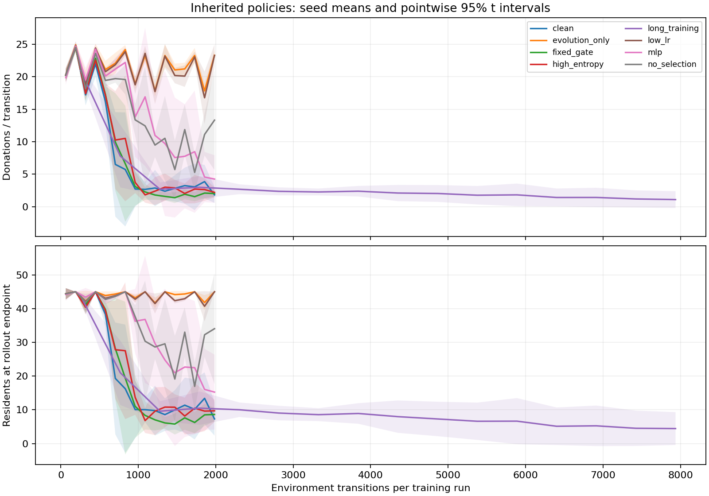
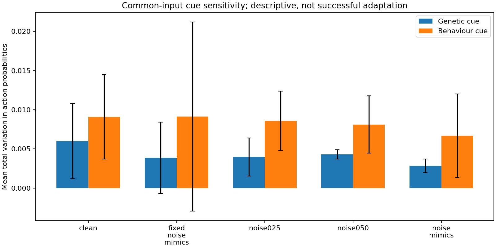

# Inherited policy diagnostics

Full-policy cue permutation is an exploratory off-manifold diagnostic, not causal reliability. Networks within a run are not independent replicates.

| Condition | Genetic cue sensitivity | Behaviour cue sensitivity | Genetic gate weight |
| --- | --- | --- | --- |
| bc150 | 0.00229; n=5; CI=[0.0019024850717376984, 0.0026710928462193597] | 0.00253; n=5; CI=[0.002279666578382755, 0.00278582934796077] | 0.47644; n=5; CI=[0.46736389799377, 0.4855212191396884] |
| bc450 | 0.00908; n=5; CI=[0.004821710586841636, 0.013347644761958674] | 0.00966; n=5; CI=[0.0072989538413819974, 0.012022955169959633] | 0.40841; n=5; CI=[0.36743591920770463, 0.44938883263630397] |
| clean | 0.00599; n=5; CI=[0.0012030167231339125, 0.010782271720841237] | 0.00910; n=5; CI=[0.003699459695811122, 0.01449079874773846] | 0.46800; n=5; CI=[0.3192902994367182, 0.6167177898473839] |
| evolution_only | 0.00157; n=5; CI=[0.0011087747277712216, 0.002025484493877265] | 0.00163; n=5; CI=[0.001053146134782526, 0.0022023100040853586] | 0.51673; n=5; CI=[0.4716628087697241, 0.561792243208705] |
| fallback | 0.00197; n=5; CI=[0.0009946926599894532, 0.0029547473875434875] | 0.00168; n=5; CI=[0.0008130718589652035, 0.002539545550386699] | 0.51916; n=5; CI=[0.48378857668488245, 0.5545368607218163] |
| fixed_gate | 0.00563; n=5; CI=[0.0024501322719107897, 0.008800440222553205] | 0.01087; n=5; CI=[0.009375672601897643, 0.012357545495851214] | 0.50000; n=5; CI=[0.5, 0.5] |
| fixed_noise_mimics | 0.00386; n=5; CI=[-0.0006923428932109387, 0.008419336718264735] | 0.00914; n=5; CI=[-0.002932852423630049, 0.02121531007717955] | 0.50000; n=5; CI=[0.5, 0.5] |
| high_entropy | 0.00537; n=5; CI=[0.0036626349812796015, 0.007073096989355641] | 0.00906; n=5; CI=[0.006033830707180221, 0.012091801659295735] | 0.37626; n=5; CI=[0.2772260327880347, 0.47530110878301024] |
| long_training | 0.00696; n=5; CI=[0.0028112529858714905, 0.01110311326975925] | 0.01194; n=5; CI=[0.0035954586998299624, 0.020284455941705568] | 0.51252; n=5; CI=[0.2788215786428996, 0.7462147687661898] |
| low_lr | 0.00171; n=5; CI=[0.0008180031441417916, 0.0025987504675796173] | 0.00219; n=5; CI=[0.0005959977817733757, 0.0037888401765286636] | 0.48585; n=5; CI=[0.43994346969534914, 0.5317476320941253] |
| mlp | 0.02003; n=5; CI=[0.014889796261716281, 0.025166948623604187] | 0.02131; n=5; CI=[0.015411635135393264, 0.027201213388610958] | not applicable |
| mutation000 | 0.00508; n=5; CI=[0.0016300138318966271, 0.008522148890182454] | 0.00682; n=5; CI=[0.004111157742945917, 0.009532344307211098] | 0.43276; n=5; CI=[0.37814476011786924, 0.4873754742881252] |
| mutation010 | 0.00594; n=5; CI=[0.0018880468240414627, 0.009997777853260108] | 0.01169; n=5; CI=[0.00610551067113731, 0.01727374579844831] | 0.33378; n=5; CI=[0.20096688326376833, 0.4665878795715357] |
| mutation020 | 0.00531; n=5; CI=[0.004116584507947373, 0.006495209073293746] | 0.01046; n=5; CI=[0.00881490400815642, 0.012096412233679755] | 0.33582; n=5; CI=[0.23152515209210853, 0.44011201494442476] |
| no_selection | 0.00315; n=5; CI=[0.0027553818413225965, 0.0035434606313807554] | 0.00493; n=5; CI=[0.00425096610580573, 0.0055998316721509326] | 0.45224; n=5; CI=[0.439805036444372, 0.4646761065633039] |
| noise025 | 0.00397; n=5; CI=[0.0015249153529549404, 0.006418198819712325] | 0.00858; n=5; CI=[0.004805388809847551, 0.012356114494336552] | 0.30796; n=5; CI=[0.1707328926457073, 0.44519570088057664] |
| noise050 | 0.00431; n=5; CI=[0.0037275988222357365, 0.004883496106110838] | 0.00811; n=5; CI=[0.004457834890867699, 0.011763265428076382] | 0.36450; n=5; CI=[0.19558733662640287, 0.5334222432407218] |
| noise_mimics | 0.00285; n=5; CI=[0.001978546612526946, 0.0037235015569996354] | 0.00668; n=5; CI=[0.0013275331561905341, 0.012025857159318244] | 0.38950; n=5; CI=[0.15697326988675384, 0.6220199035535435] |
| random_placement | 0.00435; n=5; CI=[0.0027181652503325358, 0.0059748307440192685] | 0.00908; n=5; CI=[0.004216857155390733, 0.013947600956857174] | 0.38830; n=5; CI=[0.3488093377065495, 0.4277871938137377] |

No genetic-to-behavioural adaptation claim is supported unless clean cooperation and the independently trained cue comparisons succeed.

Paired seed-level contrasts and the explicit regression status: [diagnostics.json](diagnostics.json).

