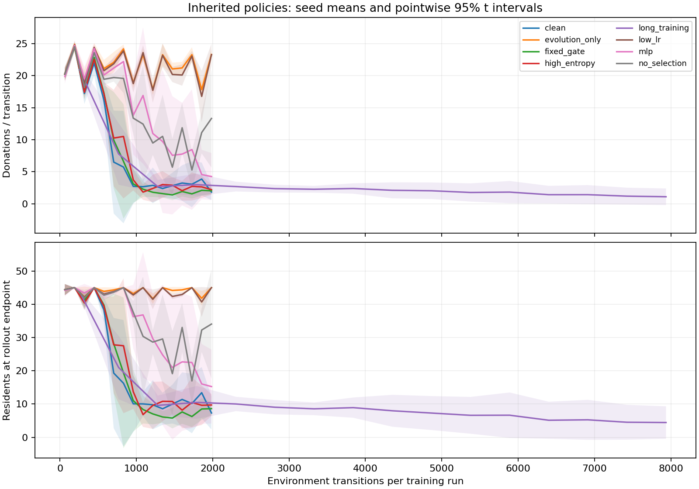

# Cooperation and cue reliability under inherited energy optimizing policies

CS329 Multi Agent Systems | Group 21 | IIT Gandhinagar

Vansh Barfiwala (24110380), Pratham Choksi (24110275), Shubham Chandak (24110335)

## Abstract

We investigate whether agents rewarded only for their own energy change learn sustained cooperation and recipient discrimination in a spatial donation game. Each founder owns an independent PPO network; offspring inherit its policy and a mutated chromosome. A survivor-based outer selection loop provides explicit competition between policy families. Gated attention combines a genetic marker with observed donation history.

The complete exploratory study contains 19 conditions and 95 runs grouped into five independent seed blocks. Each checkpoint is evaluated in 3 fresh worlds. Clean trained populations finish with 0.00 residents on average and 0.1864 donations per resident transition; the fourfold-budget condition finishes with 0.00 residents. These finite-budget observations do not establish emergent kin selection. The study tests model, optimizer and environmental alternatives and reports negative outcomes alongside positive controls.

## Decision problem and research questions

At each transition an agent chooses whether to stay, move to one of four cardinal cells, or donate to an observed neighbour. Giving costs C to the donor and adds B to the recipient. Agents observe local energy, relative positions, a corrected chromosome-similarity cue and recent donation history. They do not observe whether a neighbour is a mimic or the true corruption probability.

The questions are whether individual energy optimization sustains cooperation; whether corruption changes full-policy use of genetic and behavioural cues; whether local reproduction increases spatial marker similarity relative to randomized placement; and whether recipient decisions are associated with the variables in Hamilton’s inequality. A diagnostic extension asks whether learning rate, exploration pressure or training duration explains the observed collapse.

## Model and objective

The partially observed Markov game uses an 18 × 18 torus, 24 founders, capacity 45, initial energy 30 and reproduction threshold 60. Default B=5, C=2, basal drain=0.6 and crowding cost=0.08 per living neighbour within Chebyshev radius 3. The horizon is 300 transitions. The energy increment before reproduction is

`ΔE_i = −0.6 − 0.08 |Ω_i| − C 1[give_i] + B × incoming_donations_i`.

Starvation terminates an individual at nonpositive energy. Reproduction divides parental energy equally, assigns a fresh persistent identity, mutates each chromosome bit with probability 0.05, and starts behavioural history at a neutral prior. Donation creates net energy B−C; reproduction conserves parent-plus-child energy. Crowding counts the full radius-3 neighbourhood; the actor observes and can target only its eight nearest neighbours, ordered by distance then storage slot. Donation recipients are fixed at decision time; crowding is computed after simultaneous movement. Movement conflicts and recyclable storage slots do not change individual identity.

The genetic feature is normalized Hamming similarity of eight-bit tags, corrected against the mean over distinct living pairs: `r_tilde = max(0, (h_ij − h_bar) / max(1 − h_bar, epsilon))`. It is a marker-based proxy, not pedigree relatedness. The behavioural feature counts donations **given** during the last ten actions, not donations received.

Each lineage maximizes its members’ individual discounted energy returns with gamma=0.99. An individual’s return terminates at its death; it does not continue through a child occupying the same slot. Policy sharing pools family samples but does not directly add recipients’ energy or future descendant fitness to a donor’s return. At completed horizons, surviving individuals are sampled to seed the next population, copying their genomes, networks and optimizer states. Total extinction supplies no selection winner. This explicit selection extension is distinct from the originally proposed within-episode mitosis.

## Algorithm and implementation

A contextual gate produces genetic and behavioural weights. Each neighbour encoder receives position, energy, both raw cues and their gated affinity. Two-head attention with 32-dimensional embeddings supplies context to movement and targeted-donation heads and a local critic. A fixed-gate ablation sets both weights to 0.5 while retaining the rest of the architecture; an MLP removes attention. Because raw cues also enter the encoder, gate weights alone cannot identify reliance.

PPO uses 64-transition rollouts, three epochs, minibatches of 64, learning rate 0.0003, GAE lambda=0.95, clipping=0.2, value coefficient=0.5, entropy coefficient=0.01 and gradient norm limit=0.5. Samples are assigned by persistent family membership. Unrelated founder networks have independent parameter and optimizer storage. Terminal death masks block credit across slot reuse. Illegal actions and mimic donations are masked.

## Experimental design

Training seeds are [42, 101, 202, 303, 404]. The common budget is 2,048 environment transitions per run; long_training uses 8,192. The longer run is a budget comparison, not a convergence guarantee. Each seed receives 3 new evaluation worlds, using training_seed + 10000 + 1000 × replicate. World means are averaged within each training seed before inference. The sample size is five independent training runs, not fifteen independent learned policies.

The design contains clean PPO; no outer selection; selection without PPO; fixed gate; MLP; cue bit-flip probabilities 0.25 and 0.5; noise plus stationary non-donating genetic mimics; fixed gate with the same attack; B/C of 1.5 and 4.5; mutation 0, 0.1 and 0.2; random offspring placement; the static-demography fallback; lower learning rate 0.00003; higher entropy coefficient 0.1; and fourfold training. Other than the named factor, settings are matched. This is a one-factor design, not a full factorial study.

All conditions run regardless of the clean feasibility screen. The screen requires every clean evaluation world to survive and donate at least 0.1 times per resident transition during its final 100 transitions, with donations in at least half those transitions. Failing this screen does not erase later measurements; it prevents claims of successful sustained cooperative adaptation. All comparisons are exploratory.

Matched clean rule controls include selfish movement, tag trust, a fixed threshold, public reputation and genuine dyadic Tit-for-tat. Unknown dyads start cooperatively; the latter remembers directed encounters by persistent identity. Untrained ancestor controls preserve the trained founder genomes and ancestry composition but restore initial neural weights. Selection-only runs separately test evolution without PPO. An untrained network has several donation actions among its available choices; its survival is not evidence that it has learned cooperation.

## Results

| Condition | Final residents | Donations per resident transition | Fraction of seeds with all evaluation worlds surviving |
| --- | --- | --- | --- |
| bc150/trained/clean | 0.0000 [0.0000, 0.0000] | 0.2730 [0.2587, 0.2872] | 0.0000 [0.0000, 0.4345] |
| bc450/trained/clean | 18.0000 [-12.6039, 48.6039] | 0.1316 [0.0508, 0.2124] | 0.4000 [0.1176, 0.7693] |
| clean/rule_dyadic_tit_for_tat/clean | 44.4000 [43.2894, 45.5106] | 0.6477 [0.6267, 0.6686] | 1.0000 [0.5655, 1.0000] |
| clean/rule_fixed_threshold/clean | 27.0000 [-3.6039, 57.6039] | 0.5928 [-0.0791, 1.2647] | 0.6000 [0.2307, 0.8824] |
| clean/rule_reputation/clean | 45.0000 [45.0000, 45.0000] | 0.9855 [0.9829, 0.9881] | 1.0000 [0.5655, 1.0000] |
| clean/rule_selfish/clean | 0.0000 [0.0000, 0.0000] | 0.0000 [0.0000, 0.0000] | 0.0000 [0.0000, 0.4345] |
| clean/rule_tag_trust/clean | 27.0000 [-3.6039, 57.6039] | 0.5727 [-0.0766, 1.2220] | 0.6000 [0.2307, 0.8824] |
| clean/trained/clean | 0.0000 [0.0000, 0.0000] | 0.1864 [0.1499, 0.2228] | 0.0000 [0.0000, 0.4345] |
| clean/untrained_ancestors/clean | 45.0000 [45.0000, 45.0000] | 0.5283 [0.5190, 0.5376] | 1.0000 [0.5655, 1.0000] |
| evolution_only/trained/clean | 45.0000 [45.0000, 45.0000] | 0.5066 [0.4846, 0.5286] | 1.0000 [0.5655, 1.0000] |
| fallback/trained/clean | 24.0000 [24.0000, 24.0000] | 0.3186 [0.2723, 0.3648] | 1.0000 [0.5655, 1.0000] |
| fixed_gate/trained/clean | 0.0000 [0.0000, 0.0000] | 0.1586 [0.1335, 0.1837] | 0.0000 [0.0000, 0.4345] |
| fixed_noise_mimics/trained/clean | 36.8000 [23.8116, 49.7884] | 0.3954 [0.3148, 0.4759] | 1.0000 [0.5655, 1.0000] |
| fixed_noise_mimics/trained/attack | 0.0000 [0.0000, 0.0000] | 0.3257 [0.2995, 0.3519] | 0.0000 [0.0000, 0.4345] |
| high_entropy/trained/clean | 0.0000 [0.0000, 0.0000] | 0.1924 [0.1645, 0.2203] | 0.0000 [0.0000, 0.4345] |
| long_training/trained/clean | 0.0000 [0.0000, 0.0000] | 0.0772 [-0.0096, 0.1640] | 0.0000 [0.0000, 0.4345] |
| low_lr/trained/clean | 45.0000 [45.0000, 45.0000] | 0.5067 [0.4614, 0.5520] | 1.0000 [0.5655, 1.0000] |
| mlp/trained/clean | 9.0667 [-5.7248, 23.8582] | 0.2444 [0.1673, 0.3216] | 0.4000 [0.1176, 0.7693] |
| mutation000/trained/clean | 0.4000 [-0.3404, 1.1404] | 0.2127 [0.1796, 0.2458] | 0.0000 [0.0000, 0.4345] |
| mutation010/trained/clean | 0.0000 [0.0000, 0.0000] | 0.1937 [0.1830, 0.2044] | 0.0000 [0.0000, 0.4345] |
| mutation020/trained/clean | 0.0000 [0.0000, 0.0000] | 0.1826 [0.1570, 0.2083] | 0.0000 [0.0000, 0.4345] |
| no_selection/trained/clean | 12.4000 [2.3620, 22.4380] | 0.3042 [0.2560, 0.3524] | 0.8000 [0.3755, 0.9638] |
| noise025/trained/clean | 0.0000 [0.0000, 0.0000] | 0.1862 [0.1802, 0.1922] | 0.0000 [0.0000, 0.4345] |
| noise050/trained/clean | 0.5333 [-0.9474, 2.0141] | 0.1863 [0.1497, 0.2229] | 0.0000 [0.0000, 0.4345] |
| noise_mimics/trained/clean | 34.8000 [10.4305, 59.1695] | 0.3976 [0.2593, 0.5358] | 0.8000 [0.3755, 0.9638] |
| noise_mimics/trained/attack | 1.2000 [-1.6913, 4.0913] | 0.3421 [0.2797, 0.4046] | 0.0000 [0.0000, 0.4345] |
| random_placement/trained/clean | 0.0000 [0.0000, 0.0000] | 0.1940 [0.1801, 0.2079] | 0.0000 [0.0000, 0.4345] |

Brackets show exploratory 95% intervals. Final population and donation intervals use Student t across seed means; the all-worlds-survive event uses Wilson intervals across seeds. Small-sample t intervals can extend beyond physical bounds. Fallback survival is forced by disabling starvation and has no ecological meaning.

### Optimizer and training budget controls

| Contrast against clean | Paired donation-rate difference and 95% interval | Exact sign-flip p | Holm-adjusted p |
| --- | --- | --- | --- |
| low_lr | 0.3203 [0.2532, 0.3874] | 0.0625 | 0.1875 |
| high_entropy | 0.0061 [-0.0436, 0.0557] | 0.8125 | 0.8125 |
| long_training | -0.1091 [-0.2031, -0.0152] | 0.0625 | 0.1875 |

The three optimizer comparisons use paired seed means. With five pairs, exact two-sided sign-flip tests have very limited resolution; lack of significance does not establish equivalence. Higher entropy directly encourages diverse actions and can preserve giving without demonstrating learned recipient discrimination. Lower learning rate can delay collapse without resolving it. Longer training tests the duration explanation only over the stated budgets.

### Cue reliability and spatial assortment

| Condition | Genetic cue sensitivity | Behavioural cue sensitivity | Genetic gate weight |
| --- | --- | --- | --- |
| clean | 0.0060 [0.0012, 0.0108] | 0.0091 [0.0037, 0.0145] | 0.4680 [0.3193, 0.6167] |
| noise025 | 0.0040 [0.0015, 0.0064] | 0.0086 [0.0048, 0.0124] | 0.3080 [0.1707, 0.4452] |
| noise050 | 0.0043 [0.0037, 0.0049] | 0.0081 [0.0045, 0.0118] | 0.3645 [0.1956, 0.5334] |
| noise_mimics | 0.0029 [0.0020, 0.0037] | 0.0067 [0.0013, 0.0120] | 0.3895 [0.1570, 0.6220] |
| fixed_noise_mimics | 0.0039 [-0.0007, 0.0084] | 0.0091 [-0.0029, 0.0212] | 0.5000 [0.5000, 0.5000] |

Sensitivity is total variation in the full action distribution after permuting one cue on identical synthetic inputs. This covers raw-cue paths, but the intervention can produce unrealistic observations. Neither it nor a change in gate weights alone proves adaptive trust.

| Paired cue contrast | Mean difference and exploratory 95% interval |
| --- | --- |
| noise025_minus_clean: genetic_tv | -0.0020 [-0.0080, 0.0040] |
| noise025_minus_clean: behavior_tv | -0.0005 [-0.0046, 0.0035] |
| noise050_minus_clean: genetic_tv | -0.0017 [-0.0063, 0.0029] |
| noise050_minus_clean: behavior_tv | -0.0010 [-0.0079, 0.0059] |
| noise_mimics_minus_noise050: genetic_tv | -0.0015 [-0.0026, -0.0003] |
| noise_mimics_minus_noise050: behavior_tv | -0.0014 [-0.0086, 0.0058] |

| Attacked policy | Post-invasion donation share to mimics | Donation-bearing training seeds | Total observed post-invasion donations |
| --- | --- | --- | --- |
| noise_mimics | 0.2758 [0.2278, 0.3239] | 5 | 12084 |
| fixed_noise_mimics | 0.2732 [0.2242, 0.3222] | 5 | 10053 |

Shares are averaged within donation-bearing worlds and then training seeds; the total exposure column is descriptive, not an independent sample count. Undefined shares never count as successful defense. A policy that stops donating to everybody has not demonstrated recipient discrimination.

| Spatial contrast | Paired difference and 95% interval |
| --- | --- |
| Local minus random offspring placement: adjacent_hamming_similarity | 0.1149 [-0.1389, 0.3687] |
| Local minus random offspring placement: opportunity_adjusted_tag_preference | -0.0017 [-0.0204, 0.0170] |

Adjacent similarity is averaged over the observed trajectory, including transients. Extinct populations have no equilibrium assortment. Opportunity-adjusted preference compares actual recipients with available neighbours, conditional on giving. Neither statistic identifies pedigree kin selection.

### Hamilton association analysis

Regression status: **exploratory fit**. The logistic model uses corrected tag similarity, donation history and B/C from independently trained conditions. It describes recipient decisions during observed trajectories, including trajectories ending in extinction. B/C is a training condition, not an input that the actor reads. The regression is an association test, not a causal validation of Hamilton’s rule.

| Predictor | Coefficient | Cluster 95% interval |
| --- | --- | --- |
| intercept | -1.3988 | [-1.7788, -1.0187] |
| corrected_tag_cue | -0.2343 | [-0.4295, -0.0391] |
| behavior_history | -0.0920 | [-0.5545, 0.3706] |
| B_over_C | -0.4344 | [-0.5322, -0.3366] |

McFadden pseudo-R²=0.0342; 60,000 sampled recipient decisions, clustered into 5 training-seed units. Small-cluster inference is exploratory. Optimizer status: Optimization terminated successfully..

## Failure analysis and interpretation

A matched one-transition environment intervention changes the donor reward by -2.0000 and the recipient reward by 5.0000 when stay is replaced with give. This confirms the immediate private cost and social benefit. It does not determine which action has the larger long-term return.

There is also an objective-level distinction. For a trajectory without reproduction, summing energy increments gives `sum_t gamma^t ΔE_t = −E_0 + (1−gamma) sum_{t=1}^{T−1} gamma^(t−1) E_t + gamma^(T−1) E_T`. At gamma=1 this reduces to terminal minus initial energy. At gamma=0.99 it additionally values earlier stored energy. This expression contains no descendant-fitness term. Reproduction adds bookkeeping terms because the implemented reward is computed before energy splitting, so the simple identity is deliberately restricted to trajectories without reproduction. Reciprocity can still raise future individual energy; the identity does not prove that donation is suboptimal.

In a world without mimics, total energy change before demographic bookkeeping is `(B−C) D − 0.6 N − 0.08 sum_i |Ω_i|`, where D is the number of donations and N is the acting population. At the default B−C=3, fewer than 0.2 donations per resident transition cannot even replace basal energy loss; crowding raises the required rate. This explains the ecological consequence of low giving, but does not explain why the optimizer learns it.

There are two different processes: within-lifetime PPO rewards immediate energy gains and delayed individual benefits, while outer selection favours policies with surviving carriers at an episode boundary. Donation’s direct cost appears in the donor’s gradient, whereas another individual’s benefit is not directly assigned to that action. Recipient reciprocity could still make giving individually beneficial, but it has to be discovered. Terminating individual returns at death further separates the objective from continuing lineage fitness. These are plausible mechanisms; the experiments do not isolate a unique causal explanation.

The control comparisons distinguish ecological feasibility, the effect of learning, the effect of selection and sensitivity to two optimizer settings and duration. Surviving hand-written rules demonstrate that the tested ecology can sustain productive donations. They do not establish that the PPO objective must find those strategies. Selection-only survival likewise cannot demonstrate genetic discrimination. Earlier shared-policy demographic and descendant-reward studies use different objectives and remain separate historical evidence.

## Limitations and scope

The study has five training seeds, finite budgets, a single base ecology and one-factor sweeps. The exploratory comparisons are not a pre-registered confirmatory test. Corruption and mimicry experiments cannot establish successful cooperative adaptation when giving or survival collapses. The marker is an eight-bit proxy that may be copied or become homogeneous. Periodic restocking adds energy at episode boundaries and is an explicit model extension. Neural family policies are frozen during evaluation. Static-demography fallback results cannot establish ecological survival. The browser simulator executes an earlier shared-policy actor and is an illustration rather than a replay of the multi-policy experiment.

The project therefore answers what occurred under the declared model and finite computational budgets. It does not prove that energy-only learning can never support cooperation, or that Hamilton’s rule is false. A positive kin-selection claim would require sustained cooperation, justified pedigree or fitness measurements, controlled recipient discrimination and robust independent replication.

## Reproducibility and submission evidence

Every one of the 95 new checkpoints has a verified weight hash, exact configuration, training curve, versions and source hashes. The actual training source is archived under `./source`. Current and archived sources match the new checkpoints. Older artifacts were preserved with their original metadata; their hashes were not rewritten to claim retraining.

Run from the repository root:

```powershell
python experiments/inheritance_study.py --complete --steps 2048 --workers 3 --worlds 3 --out results/submission_study
python evaluation/inheritance_report.py --study-dir results/submission_study
python evaluation/final_report.py --study-dir results/submission_study
python -m pytest -q
node --test tests/web_simulation.test.cjs
python visualizer/export_web_data.py --check
```

Matching checkpoints are reused only after protocol and source verification. Changed settings or source require a separate output directory. Exact library versions appear in each checkpoint sidecar. The artifact manifest covers analysis, source, checkpoints, diagnostics, report-generation sources and figures.

[Full results and uncertainty](./results.md) · [Raw evaluations](./analysis.json) · [Diagnostic data](./submission_diagnostics.json) · [Experimental protocol](../../docs/final_report.md)



## Alignment with the project guidelines

| Guideline | Submission evidence |
| --- | --- |
| Clear computational question | Decision problem, private energy objective and stated research questions |
| Model and algorithm | Markov game, energy equation, inheritance, selection and gated-attention PPO |
| Implementation | Custom environment, dynamic identity handling, neural and scripted strategies |
| Baselines | MLP, fixed gate, dyadic Tit-for-tat, reputation, selfish and untrained controls |
| Meaningful experimental variation | Noise, attacks, B/C, mutation, placement, selection, learning rate, entropy and budget |
| Quantitative evaluation | Independent seed summaries, intervals, paired comparisons, cue probes and association analysis |
| Results and limitations | Negative and positive controls, objective analysis and explicit limits on interpretation |

The guidelines do not require a positive result. This report presents the implemented study and the evidence it supports; the instructor determines marks.

## Contributions and references

The ideation assigned environment and demographic modeling to Vansh Barfiwala; gating, cues and attention to Pratham Choksi; PPO and evaluation to Shubham Chandak. These are the team’s declared responsibilities, not an independent authorship audit.

Hamilton (1964), The genetical evolution of social behaviour, parts I and II; Leibo et al. (2017), Multi-agent reinforcement learning in sequential social dilemmas; Hughes et al. (2018), Inequity aversion improves cooperation in intertemporal social dilemmas; Jaques et al. (2019), Social influence as intrinsic motivation for multi-agent deep reinforcement learning; Lupu and Precup (2020), Gifting in multi-agent reinforcement learning. Bibliographic background follows the supplied ideation; no novelty or literature-completeness claim is made.
